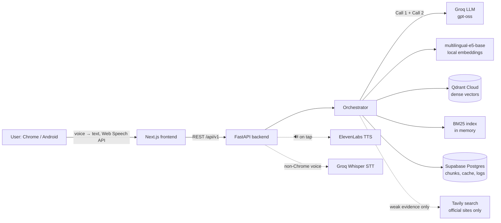
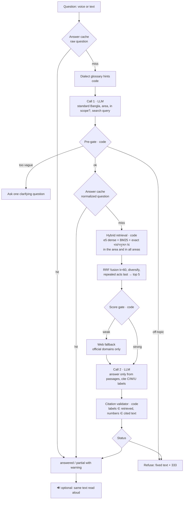
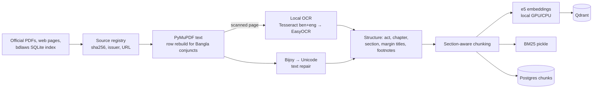

# অধিকারAI (AdhikarAI)

**সরকারি নথি থেকে আপনার অধিকারের উত্তর** — a voice-first Bangla assistant for land services, police GD, social allowances, workers' rights and other Bangladesh laws. Users speak or type in standard Bangla, a regional dialect, Banglish or English. Answers are generated only from retrieved government text (plus the user's own document, if attached), are shown with citations, and can be read aloud with 🔊. When no source supports an answer, the assistant says so and points to the national helpline 333.

## Project and team

| | |
|---|---|
| **Project** | AdhikarAI (অধিকারAI) — evidence-grounded legal and public-service information in Bangla |
| **Team** | **Phantom Troupe** |
| **Event** | CoU AI Hackathon 2026 · final demo 24 Nov 2026 |
| **Repository** | <https://github.com/jihadmia35/Adhikar-AI> |

**Members**

- Md Sazid Islam Sakib
- Nahiyan Noor
- Jihad Mia

More detail: build plan and progress in [`plan.md`](plan.md), the architecture spec in [`docs/pipeline.md`](docs/pipeline.md), the demo in [`docs/demo_script.md`](docs/demo_script.md).

## Problem

People in Bangladesh regularly need to know their rights and the official procedure in everyday situations: must an employer give an appointment letter, how do I check whether my land mutation (নামজারি) is done, how do I file a police General Diary for a lost NID, who can get the old-age allowance? The answers exist, but:

- they are spread across many government websites and long PDFs, some typed in old Bijoy/SutonnyMJ fonts that copy out as garbled text;
- they are written in formal legal Bangla (often the older সাধু ভাষা) or in English;
- many people ask by voice, in a regional dialect or in Banglish, and some find long text hard to read;
- general-purpose chatbots answer confidently without sources and can invent laws, fees or deadlines — dangerous for legal questions.

## Solution

AdhikarAI answers **only from official text it has retrieved, and shows the source of every claim**:

1. Ask by voice or text, in standard Bangla, a regional dialect, Banglish or English.
2. The question is rewritten into standard Bangla and classified into one of five areas.
3. It is searched in **73,805 passages from 1,927 official documents** with hybrid (meaning + keyword) search.
4. An LLM writes a short answer in simple Bangla using only those passages, with numbered citations to the act and section.
5. Code checks the answer: every citation must point to a retrieved passage and every number must appear in the cited source. If nothing supports an answer, it refuses with a fixed message and the helpline 333 instead of guessing.
6. The answer can be read aloud (🔊), and a personal document (deed, letter, notice) can be attached for one session — it is never stored or indexed.

AdhikarAI gives general information, not legal advice.

## Features

- **Voice input** — Chrome speech recognition (`bn-BD` / `en`), with Groq Whisper as the fallback for other browsers; the recognized text is shown for correction before sending.
- **Dialects, Banglish and English** — 10 regional dialects tested (Chattogram, Noakhali, Cumilla, Sylhet, Barishal, Rangpur, Mymensingh, Dhaka, Khulna, Rajshahi).
- **Grounded answers with citations** — tap a citation to read the exact section text and open the official source.
- **Safe refusal and clarification** — off-topic or unsupported questions are refused with the helpline 333; questions too vague to search get one clarifying question.
- **Five areas** — land (`land`), police GD (`gd`), social allowances (`allowance`), workers' rights (`labour`) and every other Bangladesh law (`general`).
- **Web fallback** — when local evidence is weak, search limited to an allow-list of official government websites; web citations are marked "verify on the linked page".
- **🔊 Read aloud** — ElevenLabs Bangla voice, streamed and cached; the browser's voice as fallback.
- **📎 Personal documents** — PDF or photo, local OCR, kept in memory for one hour, cited separately as "আপনার নথি", never as law.
- **⚖️ Conflicting official sources** — when the retrieved documents give different fees, amounts, ages, time limits or document requirements for the same case, the answer shows both values with both citations instead of silently picking one. A disagreement is resolved only by verifiable evidence (a repealed act, an amendment act that names the other); a later year alone never decides. Historical figures and different applicant groups are recognised as such.
- **💬 Follow-up questions** — ask "তাহলে কোথায় অভিযোগ করব?" without repeating the story. Earlier sources are reloaded and re-checked (still present, unchanged, not repealed, relevant) before reuse, and each answer cites its own sources. Conversations stay in memory only (2 hours) and belong to the browser tab that started them.
- **Source browser** (`/sources`), **admin panel** (`/admin`: upload, OCR, index, delete documents), **retrieval trace** (`/?debug`) and **👍/👎 feedback**.

## How the AI works (AI engineering pipeline)

### System architecture



### Query-time pipeline (one question)



| Step | Runs as | What it does |
|---|---|---|
| Dialect hints | code (`services/dialect_hints.py`) | finds known dialect words (কিল্লাই, ক্যামনে, মুই…) and adds their standard meaning to the Call 1 input |
| Call 1 | LLM (`prompts/normalize.md`) | rewrites into standard Bangla without changing meaning, negation or person; picks the area; writes a search query in official terms |
| Pre-gate | code | refuses off-topic questions, asks for clarification, never answers here |
| Retrieval | code (`services/retrieval_service.py`) | dense search (Qdrant, e5 `query:`/`passage:`), BM25 with a Bangla tokenizer, and an exact section-number list, run in the classified area and across all areas |
| Fusion | code | Reciprocal Rank Fusion (k = 60), one passage per section, repealed acts and special-scope acts (e.g. EPZ) ranked last |
| Score gate + web | code + Tavily | too little evidence → official-site web search; still nothing → refusal |
| Call 2 | LLM (`prompts/answer_bn.md`) | writes the answer from labelled passages only; retrieved text is treated as evidence, never as instructions |
| Validation | code (`services/citation_validator.py`) | drops citations to anything not retrieved; flags any number not found in its cited passage (`partial` + warning); no valid citation → refusal |
| Cache, log | Postgres | answers cached by question hash (refusals never); query log (see *What is stored about questions*) |

**Design rules:** at most **2 LLM calls** per question (Groq free tier); citations are built from stored metadata, never from model text; the refusal text is defined once in code; personal documents are never embedded, cached or logged; Groq, Tavily and ElevenLabs calls have timeouts and bounded retries.

### Offline ingestion pipeline



### Evaluation so far

- **214 automated tests** (LLM, network and database mocked) for parsing, chunking, retrieval, fusion, the orchestrator, citation validation, web fallback, TTS and dialect checks.
- **Dialect normalization** (`scripts/eval_normalization.py`, 38 questions, 10 dialects): fully correct rewrites went from **21/38 to 34/38** after the dialect guide and code glossary, with **no reversed meanings** left (`plan.md` Phase 14). The test questions still need review by native speakers.
- **Retrieval and answer accuracy are not measured yet**: the 24-question gold set (`data/evaluation/gold.jsonl`) waits for human labels.


## Run it

**One-time setup:**

```bash
cp .env.example .env            # fill in DATABASE_URL, QDRANT_URL/KEY, GROQ_API_KEY, LLM_MODEL, APP_SECRET_KEY
cd backend
uv venv --python 3.12 .venv && uv pip install --python .venv/bin/python -r requirements.txt
.venv/bin/python scripts/check_connections.py    # expect OK for postgres, qdrant and groq
.venv/bin/python scripts/create_tables.py        # Supabase tables (idempotent)
.venv/bin/python scripts/create_admin.py you@example.com   # admin account (asks for the password)
cd ../frontend && npm install
```

**Get the data.** The dataset and indexes are too large for git, so choose one:

- **Join the team's existing databases (minutes):** copy `data/index/bm25.pkl` (about 356 MB) from a teammate. Also copy `data/processed/` to read section text in the admin panel. Don't run ingestion: it would rewrite the shared databases.
- **Build your own empty databases (several hours, GPU recommended):** copy `data/DataSet/` (about 1.1 GB) from the team, then:
  ```bash
  cd backend
  .venv/bin/python scripts/ingest_dataset.py --list
  .venv/bin/python scripts/ingest_dataset.py --resume     # every pending step; safe to re-run after a failure
  .venv/bin/python scripts/ingest_dataset.py --status     # the counts must match
  ```

**Every time, in two terminals:**

```bash
# terminal 1: API on :8000 (docs at http://localhost:8000/docs)
cd backend && .venv/bin/uvicorn app.main:app --port 8000

# terminal 2: UI on :3000 (open in Chrome for voice)
cd frontend && npm run dev               # or for the demo: npm run build && npx next start -p 3000
```

Then open:
- <http://localhost:3000> to ask questions by voice or text, attach your own document with 📎, and hear an answer with 🔊
- <http://localhost:3000/admin> to manage the knowledge base (log in with an admin email and password)
- <http://localhost:3000/sources> to browse documents, and <http://localhost:3000/about> for a plain-language explanation
- <http://localhost:3000/?debug> to show "এই উত্তর কীভাবে পাওয়া গেল" (the retrieval trace) under each answer

The frontend talks to `http://localhost:8000` by default. Set `NEXT_PUBLIC_API_URL` in `frontend/.env.local` if the API runs elsewhere, and add the UI's origin to `CORS_ORIGINS` in `.env`.

The API loads the whole BM25 index into memory at startup. Run a single worker.

Requirements: Python 3.12 via [uv](https://docs.astral.sh/uv/), Node.js 22, ffmpeg. For OCR: Tesseract with Bengali (`sudo dnf install tesseract tesseract-langpack-ben`); EasyOCR is installed from `requirements.txt` as the second engine.

## Admin panel (`/admin`)

- **See the knowledge** the AI answers from: a searchable, paginated list of documents per area, with section and chunk counts, issuer and source link, and the full text of each section.
- **Upload** an official PDF (text, old Bijoy font or scanned) or an image, with its area, official title, issuer and source URL. Ingestion runs in the background with live steps: original preserved with sha256, text extraction and OCR, chunking, local embedding, Qdrant, Postgres, then the BM25 index is swapped into the running API. The document is answerable immediately, and re-uploading the same document ID replaces the old version.
- **Delete** a document: it's removed from Qdrant, Postgres, BM25 and the processed data. Built-in documents (`data/dataset_registry.json`) can't be replaced or deleted here.
- Every change clears the answer cache, so earlier answers and refusals are recomputed.
- **Caveat:** uploads are not in the dataset chunk cache. A later `ingest_dataset.py` step rebuilds BM25 without them, so upload them again afterwards.
- **Evaluation:** the মূল্যায়ন tab shows the last saved `results.json`.
- **Login:** admin accounts live in the `admin_users` table. Passwords are stored only as salted scrypt hashes, and there's no plain-text copy anywhere. Create an account or reset a password with `scripts/create_admin.py <email>`. Login returns a session token signed with `APP_SECRET_KEY`, valid for `ADMIN_SESSION_HOURS` (12 by default). If `APP_SECRET_KEY` is unset, sessions end whenever the API restarts. `ADMIN_TOKEN` is an optional static key for scripts.

## Personal documents (users)

On the chat screen, 📎 attaches a PDF or photo (deed, appointment letter, notice…). The text is extracted, using local OCR for scans and photos, and then:

- it is **never embedded or added to the knowledge base**, never saved to a database, never cached, and its text is never logged
- processing uses short-lived temporary files: uploads over 1 MB are spooled to disk, and PDF extraction and Tesseract write temp files that are removed afterwards
- the selected passages are sent to Groq to write the answer. They are never sent to web search, and the answer is never sent to ElevenLabs: 🔊 uses the browser's voice on the device
- it lives in server memory for `USER_DOC_TTL_MINUTES` (default 60), or until the user removes it
- for each question, the most relevant passages of the document go to the answer step next to the official sources, and the answer cites them separately as **আপনার নথি**, never as law

## What is stored about questions

With Postgres configured, `query_logs` keeps the normalized question and, when it is short and has no phone or NID-like number, the original. The normalized question, the answer cache and the query sent to Tavily are **not redacted**, so users are told not to type personal details. Questions about a personal document store no text.

Follow-up conversations (the citizen's messages, each answer's text and the ids of the sources it cited) are kept only in the API process's memory for `CONVERSATION_TTL_MINUTES` (120) after the last message, and are lost on restart. For a personal-document answer the answer text and the document passages are not kept.

The audio of answers read aloud is kept in `data/tts_cache/` (git-ignored), named by a hash of the spoken text. Delete the folder to clear it; files are regenerated on demand.

## Environment variables (`.env`, names only — see `.env.example`)

| Variable | Purpose |
|---|---|
| `DATABASE_URL` | Supabase **session pooler** string (`postgresql://…`; the asyncpg driver and password escaping are handled automatically) |
| `QDRANT_URL`, `QDRANT_API_KEY`, `QDRANT_COLLECTION` | Qdrant Cloud free cluster |
| `GROQ_API_KEY`, `LLM_MODEL`, `STT_MODEL` | Groq free tier; `LLM_MODEL=openai/gpt-oss-20b` was best in our 21 Nov comparison (`scripts/test_llm_models.py`) |
| `EMBEDDING_MODEL`, `EMBEDDING_DIM`, `EMBEDDING_DEVICE` | local `intfloat/multilingual-e5-base`, 768 dims |
| `RETRIEVAL_MIN_SCORE` | score gate (tune with `scripts/run_eval.py`) |
| `TAVILY_API_KEY`, `WEB_FALLBACK`, `WEB_TRIGGER_SCORE`, `WEB_MAX_RESULTS` | web fallback; off by default |
| `ELEVENLABS_API_KEY`, `TTS_ENABLED`, `TTS_MODEL_ID`, `TTS_VOICE_ID`, `TTS_MAX_CHARS` | 🔊 read-aloud (ElevenLabs free tier, ~10k characters/month; audio cached in `data/tts_cache/`). Without a key the button uses the browser's Bangla voice |
| `WEB_ALLOWED_DOMAINS` | optional override of the official-site list. Omit it for the default: an empty value blocks every site |
| `OCR_PROVIDER`, `OCR_SECOND_ENGINE`, `OCR_DEVICE`, `OCR_MIN_CONFIDENCE` | local OCR only |
| `APP_SECRET_KEY`, `ADMIN_SESSION_HOURS` | signs admin login sessions (long random string); session length |
| `ADMIN_TOKEN`, `MAX_UPLOAD_MB` | optional static admin key for scripts; upload size limit |
| `USER_DOC_TTL_MINUTES` | how long a user's personal document stays in memory |
| `NEXT_PUBLIC_API_URL` | in `frontend/.env.local`, default `http://localhost:8000` |

## Adding documents

- **One document:** upload it in `/admin`. Only that document is embedded, and it is live immediately.
- **A dataset folder:** register a step in `backend/app/ingestion/dataset_sources.py`, then:
  ```bash
  cd backend
  .venv/bin/python scripts/ingest_dataset.py --step <name> --convert-only   # parse/OCR only
  .venv/bin/python scripts/ingest_dataset.py --step <name>                  # embed and index only this step
  ```
  Restart the API afterwards so it loads the new index.
- **Compare OCR engines on a scan:** `.venv/bin/python scripts/compare_ocr.py scan.pdf --pages 1-3`

> **Do not run `ingest_jsonl.py`, or `ingest_pdf.py` without `--no-index`, against the live databases.** Both re-embed the whole corpus and overwrite Qdrant and BM25. Their Postgres write then fails, because it needs 73,805 query parameters and asyncpg allows 32,767. `ingest_dataset.py --wipe --yes` deletes everything.

## Tests and evaluation

```bash
cd backend
.venv/bin/python -m pytest                                  # unit tests; LLM/network mocked, no external calls
.venv/bin/python -m pytest tests/unit/test_chunker.py::test_short_section_unchanged
.venv/bin/ruff check . && .venv/bin/ruff format --check .
.venv/bin/python scripts/try_retrieval.py "লে-অফ হলে শ্রমিক কি ক্ষতিপূরণ পায়?" --area labour
.venv/bin/python scripts/eval_retrieval.py                  # dense vs BM25 vs hybrid on retrieval_seed.jsonl
.venv/bin/python scripts/run_eval.py                        # full pipeline on data/evaluation/gold.jsonl -> results.json
.venv/bin/python scripts/eval_normalization.py --sleep 25   # dialect → standard Bangla on 38 questions (10 dialects)
cd ../frontend && npm run lint && npm run build
```

`data/evaluation/gold.jsonl` holds 24 test questions. **`expected_chunk_ids`, `must_include` and `must_not_include` must be filled in by a human reviewer** before Recall@5, MRR and answer coverage can be measured.

- **The saved results are out of date.** `results.json` is from 21 Nov, on 55 chunks and `openai/gpt-oss-20b`. It does not describe the current system.
- Use `run_eval.py --fresh` after any change to data, code or prompts. Without it the run resumes from that model's old checkpoint.
- `run_eval.py` does not use the web fallback, so it measures the local corpus only.

## API

| Method | Path | |
|---|---|---|
| POST | `/api/v1/chat` | `{"message", "area"?, "debug"?, "user_doc_id"?}` → `{status, answer, citations[], normalized_question, area, warnings[], trace?, latency_ms, cached, request_id}` |
| POST | `/api/v1/tts` | `{text, token}` (the answer and its `speech_token` from `/chat`) → `{audio_url, cached, chars}`; 403 if the text was not produced by the API |
| GET | `/api/v1/tts/{key}.mp3` | the answer's audio: streamed from ElevenLabs the first time, then served from the cache |
| POST | `/api/v1/chat/voice/transcribe` | audio (≤10 MB, ≤30 s), `language` = bn\|en → `{transcript}` (Groq Whisper fallback; silence and prompt echoes rejected) |
| POST | `/api/v1/chat/voice` | audio → chat response + `transcript` |
| GET | `/api/v1/sources?area=&q=&page=&page_size=` | `{items[], total, page, page_size, pages, counts}` |
| GET | `/api/v1/sources/documents/{id}`, `/api/v1/sources/{chunk_id}` | a document's sections; full text with amendment notes |
| POST | `/api/v1/user-docs` | personal PDF or image → `{doc_id, filename, pages, methods, preview, expires_at}` (in memory only); pass `user_doc_id` to `/chat` |
| GET/DELETE | `/api/v1/user-docs/{doc_id}` | inspect a personal document, or remove it now |
| POST | `/api/v1/admin/login` | `{email, password}` → `{token, email, expires_at}` |
| GET/POST/DELETE | `/api/v1/admin/documents[/{id}]`, `/admin/jobs[/{id}]`, `/admin/check` | knowledge-base management (Bearer session token) |
| POST | `/api/v1/feedback` | `{query_log_id?, rating: up\|down, comment?}` → `{ok, stored}` |
| GET | `/api/v1/health`, `/api/v1/eval/latest` | service status; latest evaluation |

```bash
curl -s localhost:8000/api/v1/chat -H 'Content-Type: application/json' \
  -d '{"message": "মালিক কি শ্রমিককে নিয়োগপত্র দিতে বাধ্য?"}'      # answered, with citations
curl -s localhost:8000/api/v1/chat -H 'Content-Type: application/json' \
  -d '{"message": "আজকে ঢাকার আবহাওয়া কেমন থাকবে?"}'               # refused with the fixed text
```

Statuses: `answered`, `partial` (a number couldn't be matched to the source, so a warning is shown), `refused` (fixed text and helpline 333), and `clarify`. On a Groq rate limit the API returns HTTP 503 `{"detail": {"code": "rate_limited", "message": "কিছুক্ষণ পর আবার চেষ্টা করুন।"}}`.

## Demo day

Follow [`docs/demo_script.md`](docs/demo_script.md). `scripts/warmup.py` wakes Supabase and Qdrant and pre-caches its questions. It does not use the web fallback and cannot cache refusals. `warmup.py --tts` also pre-generates their 🔊 audio, so it plays instantly and spends no credits on stage.

**Weak venue internet:** use a phone hotspot and set `WEB_FALLBACK=false`. Groq and Chrome speech recognition always need internet, so there is no fully offline mode. Cached 🔊 audio is served by the API itself; new audio needs ElevenLabs. Retrieval also needs Qdrant: BM25 alone is not a fallback.

**Local Qdrant (not rehearsed, prepare days ahead):** this re-embeds all 73,805 chunks, which takes hours.

```bash
cp data/index/bm25.pkl data/index/bm25.backup.pkl       # the command below overwrites it
docker compose -f infra/docker-compose.yml --profile offline up -d qdrant
# in .env:  QDRANT_URL=http://localhost:6333   QDRANT_API_KEY=   DATABASE_URL=   WEB_FALLBACK=false
# check QDRANT_URL really is localhost before the next line
cd backend && .venv/bin/python scripts/ingest_jsonl.py --skip-postgres
```

Without Postgres the answer cache is in-memory, questions aren't logged and email admin login is unavailable.

## Tech stack, models, APIs and datasets

| Layer | Technology |
|---|---|
| Backend | Python 3.12, FastAPI, Pydantic v2, pydantic-settings, Uvicorn, SQLAlchemy 2 (async) + asyncpg, httpx |
| Frontend | Next.js 15 (App Router), React 19, TypeScript (strict), Tailwind CSS, shadcn/ui (Radix UI), lucide-react |
| Databases | Supabase PostgreSQL (documents, chunks, answer cache, logs, admin users), Qdrant Cloud (vectors), BM25 index file |
| Retrieval | `rank_bm25` with a Bangla-aware tokenizer, Reciprocal Rank Fusion |
| Documents | PyMuPDF, own Bijoy/SutonnyMJ → Unicode converter, Tesseract OCR (`ben+eng`), EasyOCR, Pillow, ffmpeg |
| Testing and quality | pytest, pytest-asyncio, ruff, ESLint, uv |

**Models**

| Model | Provider | Used for |
|---|---|---|
| `openai/gpt-oss-120b`, `openai/gpt-oss-20b` | Groq (free tier) | Call 1 (normalize, classify) and Call 2 (grounded answer); chosen by `LLM_MODEL` |
| `qwen/qwen3.8-27b` | Groq | model comparison only (`scripts/test_llm_models.py`) |
| `whisper-large-v3` | Groq | speech-to-text fallback for browsers without Bangla speech recognition |
| `intfloat/multilingual-e5-base` | Hugging Face, run locally | 768-dim embeddings for questions and passages |
| `eleven_v3` | ElevenLabs (free tier) | 🔊 Bangla read-aloud |
| Chrome speech recognition and browser voices | Web Speech API | voice input; read-aloud fallback |

**APIs:** Groq API · Qdrant Cloud API · Supabase (PostgreSQL) · Tavily Search API (web fallback, official domains only) · ElevenLabs Text-to-Speech API · browser Web Speech API.

**Datasets (official sources)**

- [Laws of Bangladesh](http://bdlaws.minlaw.gov.bd/), Legislative and Parliamentary Affairs Division, Ministry of Law, Justice and Parliamentary Affairs: [Labour Act 2006](http://bdlaws.minlaw.gov.bd/act-952.html), [Labour (Amendment) Act 2026](http://bdlaws.minlaw.gov.bd/act-1672.html), [Constitution](http://bdlaws.minlaw.gov.bd/act-957.html) and the Chronological Index
- Ministry of Land: [minland.gov.bd](https://minland.gov.bd/), [land.gov.bd](https://land.gov.bd/), [mutation.land.gov.bd](https://mutation.land.gov.bd/), [case.gov.bd](https://case.gov.bd/)
- Bangladesh Police: [police.gov.bd](https://www.police.gov.bd/), [Online GD](https://gd.police.gov.bd/)
- [Department of Social Services](https://dss.gov.bd/)
- [National Human Rights Commission](https://nhrc.org.bd/)
- Guides compiled by the team from scraped pages of government sites (not official publications)
- Per-file provenance and sha256: `data/sources_log.csv`; document registry: `data/dataset_registry.json`

Corpus as of 22 Nov 2026, with the same count in Postgres, Qdrant and BM25:

| Area | Chunks | Main sources |
|---|---:|---|
| `land` | 4,048 | Ministry of Land acts, rules, policies and portal pages; land acts from the bdlaws index |
| `gd` | 1,376 | Online GD manual, Bangladesh Police documents; police acts from the bdlaws index |
| `allowance` | 1,426 | Department of Social Services allowance documents and pages |
| `labour` | 1,369 | Labour Act 2006, Amendment Act 2026, other labour acts from the bdlaws index |
| `general` | 65,586 | Constitution, bdlaws Chronological Index (1799–2026), NHRC, other DSS documents |
| **Total** | **73,805** | **1,927 documents** |

400 of these chunks come from guides the team compiled from scraped government web pages. They are titled "(সংকলিত নির্দেশিকা)" and are not official publications. Sources have not been legally reviewed: the extraction log marks every file either `unverified` or `needs_review`.

**Evaluation data (made by the team):** `data/evaluation/gold.jsonl` (24 questions), `retrieval_seed.jsonl`, and `dialect_normalization.jsonl` (38 dialect questions written with Claude's help; awaiting native-speaker review).

## AI tools used

| Tool | Used for |
|---|---|
| [Claude Code](https://claude.com/claude-code) (Anthropic) | writing and refactoring backend and frontend code, tests, prompts and documentation; debugging; drafting the dialect test questions |
| Claude (Anthropic) | research |
| ChatGPT (OpenAI) | research |
| Gemini (Google) | research |
| Perplexity | research |

All AI-assisted output was reviewed by the team. The AI models inside the product itself are listed under *Models* above.

## Third-party code and assets

| What | Where in this repo | Source and licence |
|---|---|---|
| shadcn/ui components (badge, button, card, collapsible, input, pagination, separator, sheet, skeleton, table, textarea, tooltip) | `frontend/components/ui/` | generated with the shadcn/ui CLI ([ui.shadcn.com](https://ui.shadcn.com)), MIT; built on Radix UI (MIT) |
| Hind Siliguri font | loaded with `next/font/google` | Indian Type Foundry via Google Fonts, SIL Open Font License 1.1 |
| lucide icons | `lucide-react` package | [lucide.dev](https://lucide.dev), ISC |
| Government documents and web pages | `data/` (not in git; see *Datasets*) | public government sources credited above; copyright stays with the issuing offices |
| Open-source libraries | `backend/requirements.txt`, `frontend/package.json` | their own licences (FastAPI, Pydantic, SQLAlchemy, qdrant-client, groq SDK, sentence-transformers, Transformers, PyTorch, rank-bm25, PyMuPDF, pytesseract, EasyOCR, Next.js, React, Tailwind CSS, Radix UI, …) |

No other code was copied into the repository. The Bijoy/SutonnyMJ converter table, parsers, retrieval, validation and prompts were written for this project.

**Development tools:** Playwright with headless Chromium (UI screenshots and voice-flow checks during development) · Docker Compose (offline profile) · uv.
