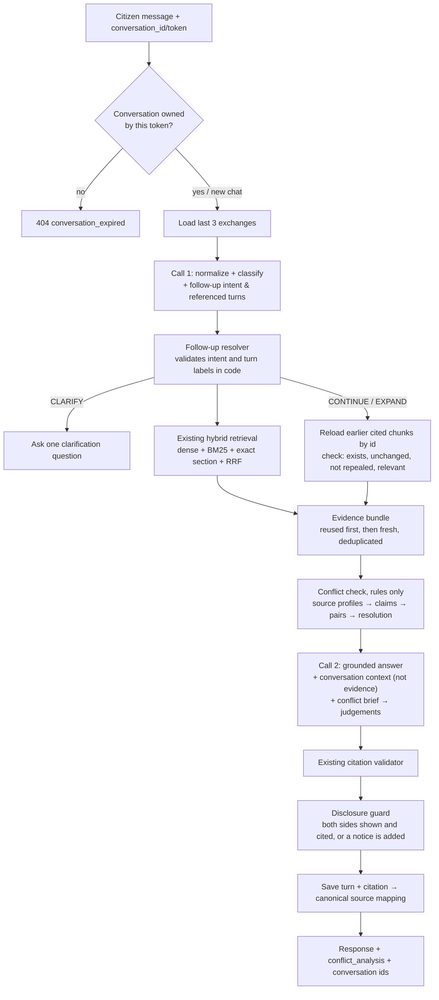

# Follow-up Conversations and Official-Source Conflict Detection

**AdhikarAI (অধিকারAI) · Technical design document**

| | |
|---|---|
| Team | Phantom Troupe — CoU AI Hackathon 2026 |
| Scope | Two capabilities added to the existing RAG assistant in response to the judges' brief |
| Requirement specifications | [`docs/specs/followup-source-continuity.md`](specs/followup-source-continuity.md), [`docs/specs/official-source-conflict-detection.md`](specs/official-source-conflict-detection.md) |
| Status | Implemented, tested and merged into `master` (build plan: `plan.md`, Phases 16 and 17) |
| Related documents | [`README.md`](../README.md) · [`docs/pipeline.md`](pipeline.md) (base architecture) · [`docs/demo_script.md`](demo_script.md) |

## Executive summary

| Capability | Problem | Outcome |
|---|---|---|
| **Follow-up conversations with source continuity** | Every question was answered in isolation, so a citizen had to repeat the whole situation; "তাহলে কোথায় অভিযোগ করব?" meant nothing on its own. | The assistant keeps the conversation, resolves references such as "তাহলে / এটার / ওই আইন", reloads and re-verifies the sources it cited earlier, and cites the evidence of each new answer. |
| **Official-source conflict detection and transparency** | When two official documents gave different figures, the model silently picked one (the previous prompt even said "use the newer document"). | Deterministic code finds disagreements in the retrieved evidence and settles them only with verifiable evidence; otherwise the answer shows both values with both citations and advises confirming with the responsible office. |

Both are integrated into the existing pipeline rather than built beside it: the same `/chat` endpoint, **at most two LLM calls per question**, no new database or infrastructure, and every answer still passes the existing citation validator. Backward compatibility is preserved: clients that send no conversation fields behave exactly as before.

Design principles:

> The conversation gives context. The cited source gives evidence. A follow-up must re-verify that its evidence still supports the new question.
>
> When official sources disagree, AdhikarAI communicates the disagreement; it does not manufacture certainty.

## Contents

1. [The pipeline: before and after](#1-the-pipeline-before-and-after)
2. [Follow-up conversations with source continuity](#2-feature-1--follow-up-conversations-with-source-continuity)
3. [Official-source conflict detection](#3-feature-2--official-source-conflict-detection)
4. [Testing and results](#4-testing-and-results)
5. [Configuration](#5-configuration)
6. [Known limitations](#6-known-limitations)
7. [Reproducing the results](#7-reproducing-the-results)

---

## 1. The pipeline: before and after

Before (one question at a time):

```
question → cache → Call 1 normalize/classify → gate → hybrid retrieval (dense + BM25 + exact section, RRF)
         → score gate / web fallback → Call 2 grounded answer → citation validator → response
```

After (new steps in bold in the diagram):



Files at a glance:

| New module | Role |
|---|---|
| `services/conversation_store.py` | In-memory conversations, ownership token, per-conversation guard |
| `services/conversation_service.py` | `/chat` around the orchestrator: ownership, history, persisting turns and sources |
| `services/followup_resolver.py` | History blocks for Call 1 / Call 2, validation of the follow-up intent |
| `services/evidence.py` | Reload and re-check earlier sources, merge with fresh evidence |
| `services/source_profile.py` | What kind of source a passage is (from evidence the repo has) |
| `services/claim_extractor.py` | Numeric claims (fees, amounts, ages, time limits) with exact provenance |
| `services/conflict_detector.py` | Context matching, classification, evidence-based resolution |
| `services/conflict_disclosure.py` | Call 2 brief, verified judgements, document claims, disclosure guard, API view |
| `prompts/followup_normalize.md`, `followup_answer.md`, `conflict_answer.md` | Extra instructions, added only when needed |
| `frontend/components/chat/conflict-notice.tsx` | Warning box for disagreements |

| Changed (small edits) | What changed |
|---|---|
| `services/orchestrator.py` | `run_turn(request, context)`; evidence bundle = reused + fresh; conflict check before Call 2; guard after validation; follow-ups skip the cache |
| `services/query_normalizer.py`, `generation_service.py` | Optional history / conflict brief in Call 1 and Call 2 |
| `services/citation_validator.py` | `citation_for()` helper (citations still built from stored metadata only) |
| `models/llm_client.py` | A 429 waits for Groq's `retry-after` (up to 20 s, still max 3 retries) |
| `prompts/answer_bn.md` | Rule 9: never pick one of two different figures; give both with labels |
| `schemas/chat.py`, `schemas/llm.py` | Optional request/response fields (backward compatible) |
| `api/routes/chat.py`, `api/dependencies.py` | Route calls the conversation service; 404 / 409 errors |
| `frontend/app/page.tsx`, `lib/types.ts`, `answer-card.tsx`, `trace-panel.tsx` | Keep the conversation per chat, "নতুন কথোপকথন", conflict notice, debug trace |

---

## 2. Feature 1 — Follow-up conversations with source continuity

### 2.1 Solution approach

1. **Remember the conversation** for the browser tab that started it, not forever and not for anyone else.
2. **Resolve the reference** ("তাহলে", "এটার জন্য", "ওই আইন", Banglish "tahole", "eta") into a standalone question, without inventing facts the citizen did not say.
3. **Reuse evidence, not old answer text.** An earlier citation is reloaded from the live index by its canonical chunk id and re-checked before it may support the new answer.
4. **Cite the current answer's own sources.** Citation numbers are rebuilt every turn; an old source may get a new number.
5. **Be honest when unsure:** an ambiguous reference gets one clarification question; anything that cannot be resolved safely falls back to a fresh search.

### 2.2 Engineering approach

**Conversation identity and ownership** (`conversation_store.py`)
- `/chat` accepts optional `conversation_id` + `conversation_token`. No id = a new conversation; old clients keep working.
- The token is a 256-bit random secret returned **once** with the first answer. Only its SHA-256 is stored and it is compared in constant time. A wrong token and an unknown id give the same `404 conversation_expired`, so ids cannot be probed. The citizens' app has no login, so this per-conversation secret is the ownership proof.
- A conversation is saved only after its first complete answer (no empty conversations on errors).
- One message at a time per conversation: a second concurrent message gets `409 conversation_busy`, so turn numbers never collide.

**Storage: in memory only.** One API process serves the demo, and CLAUDE.md says no Redis unless needed. The store sits behind a `ConversationStore` interface (`get`, `save`, `guard`, `delete`), so a Redis store for several workers would be one new class. Limits: 120 minutes after the last message (sliding), at most 1,000 conversations (least recently used evicted), last 40 turns kept per conversation.

**What is stored per assistant turn:** the answer text, status, area, the standalone question it answered, and for each citation the marker, kind, canonical chunk id, document id, section, a **SHA-256 hash of the chunk text** (detects edited chunks), how it was retrieved (`dense`, `bm25`, `hybrid`, `exact`, `reused`, `web`, `cache`) and its rank. Never a copy of the knowledge base.

**Follow-up resolution inside Call 1** (`followup_resolver.py`, `prompts/followup_normalize.md`). A separate resolver call would break the 2-call rule, so Call 1 also receives the last 3 exchanges as `[T1] [T2] [T3]` (earlier standalone questions, area, status and cited source titles, never the answer prose) and returns two extra keys:

| Intent | Meaning | What the pipeline does |
|---|---|---|
| `CONTINUE` | Same issue; earlier sources probably cover it | Reuse re-checked earlier sources first, plus fresh retrieval |
| `EXPAND` | Same issue, new information needed | Reuse up to 2 earlier sources, more room for fresh retrieval |
| `NEW_TOPIC` | Different problem | Fresh retrieval only; no earlier sources, no history in Call 2 |
| `CLARIFY` | Reference ambiguous | Ask one short question; no substantive answer |

Code validates the output: only labels that were shown map to turn ids; an unknown intent, a malformed Call 1 or a `CLARIFY` without a question all fall back to fresh retrieval; a `CONTINUE`/`EXPAND` without a label refers to the latest exchange.

**Evidence continuity** (`evidence.py`). An earlier citation is reused only if all of these hold:
1. it is an official chunk (web passages are searched again; personal-document passages are never stored);
2. the chunk still exists in the live index (an admin may have deleted the document);
3. its text hash is unchanged since it was cited;
4. its act is not repealed (`[রহিত]`);
5. it is relevant to the resolved question: among the fresh results, or sharing a distinctive term (BM25 IDF ≥ 1.5) with it.

Fresh retrieval **always** runs through the unchanged hybrid pipeline (it is local; judging "is the old evidence enough" would need a third LLM call). Reused chunks go first, fresh ones fill the rest, deduplicated by chunk id, so the prompt stays the same size. If fresh retrieval finds nothing but verified earlier evidence exists, the score gate no longer refuses.

**Answer generation** (`prompts/followup_answer.md`). Call 2 gets the citizen's original message, the resolved question and the referenced exchanges with a 300-character answer excerpt marked "not evidence". Rules: history is context, never evidence; every fact must cite a passage of *this* message; correct an earlier answer politely if the current passages contradict it.

**Cache.** The answer cache key cannot see the conversation, so follow-ups never read or write it. The follow-up prompts are left out of the cache fingerprint, so adding them did not discard the warm demo cache.

**Privacy.** For a personal-document answer the answer text is not kept (it may quote the document) and `[U…]` citations are never stored; the user's document stays in memory with its own one-hour lifetime as before.

**Frontend.** The page keeps `{conversation_id, token}` for the chat, sends both with each message, "নতুন কথোপকথন" starts a new conversation, and an expired conversation is forgotten so "retry" starts a fresh one. `?debug` shows the follow-up decision and reused sources.

**Rate limits.** A follow-up usually comes seconds after an answer, inside Groq's per-minute token window. The LLM client now honours Groq's `retry-after` on a 429 (up to `LLM_RATE_LIMIT_MAX_WAIT_S` = 20 s per retry, still max 3 retries) instead of giving up after 8 s.

### 2.3 How many follow-up questions can it handle?

| Limit | Value | Where |
|---|---|---|
| Follow-ups per conversation | **No limit.** Measured: 1 question + 50 follow-ups in one conversation, all answered | capacity run below |
| Turns remembered per conversation | Last 40 turns (20 question/answer pairs); older ones are dropped | `MAX_TURNS_KEPT` |
| History the model sees per follow-up | Last 3 exchanges (keeps Call 1 within the token budget) | `CONVERSATION_HISTORY_EXCHANGES` |
| Earlier sources reused per answer | 3 for CONTINUE, 2 for EXPAND | `CONVERSATION_MAX_REUSED_SOURCES` |
| Conversation lifetime | 120 minutes after the last message | `CONVERSATION_TTL_MINUTES` |
| Conversations held at once | 1,000 (least recently used evicted); 1,200 conversations used ≈1.4 MB | `CONVERSATION_MAX_COUNT` |
| Overhead of the conversation layer | ≈1 ms per follow-up (without LLM and network) | capacity run |
| **Practical limit** | The Groq tier: each follow-up is 2 uncached calls (≈8–9k tokens). On the free tier (8k tokens/minute, 200k/day per model) that is about one follow-up per minute and roughly 20–25 questions per day per model; a paid key removes this limit | Groq |

---

## 3. Feature 2 — Official-source conflict detection

### 3.1 Solution approach

**Code finds and decides; the LLM only interprets; code double-checks the final answer.**

1. Profile every retrieved source with metadata the repository actually has.
2. Extract comparable claims (fees, allowance amounts, ages, income limits, time limits, validity, required papers) with exact provenance.
3. Compare claims only after checking they are about the same service and the same situation.
4. Resolve a disagreement only with verifiable evidence; otherwise keep it unresolved.
5. Give Call 2 a structured brief; accept its judgements only when they are backed by passage text.
6. Guarantee disclosure in code: an answer that states one side of an unresolved disagreement gets both.

### 3.2 Engineering approach

**Source profile** (`source_profile.py`). From the dataset step and parser each document was ingested with (`data/dataset_registry.json`) and its title, never from its domain name:
- source type: act, ordinance, order, rules, regulation, policy, circular, citizen charter, official webpage, official document, **compiled guide** (`md-*`, not official text), web search result;
- the year printed in the title (a publication hint only; none for compiled guides and webpages, whose titles carry the year of the law they describe);
- status `repealed` when the title has `[রহিত]`, otherwise **`unknown`**, never "active";
- amendment acts: "X (সংশোধন) আইন, 2026" is linked to "X আইন, 2006".

The data has no effective dates, verified dates or supersession records; those stay unknown and are listed as a limitation.

**Claim extraction without an LLM** (`claim_extractor.py`). Regular expressions over the passage give a number, its unit and the exact sentence:
- amounts: N টাকা / ৳ / Tk (with হাজার), classified by cue words in the same clause: application fee, allowance amount, tax, fine, income limit;
- time: N দিন / কার্যদিবস / মাস / বছর / ঘণ্টা, including number words (তিন মাস); working days and calendar days are kept apart; classified as deadline, validity or age limit;
- context recorded per claim: applicant (পুরুষ, মহিলা, প্রতিবন্ধী, শ্রমিক …), variant (জরুরি, সাধারণ, অনলাইন …), place, allowance programme, period (fiscal year, year, or "historical" for past tense such as ছিল / প্রাথমিকভাবে), min/max, conditions.

Noise found in the real corpus is handled: budgets ("৫২৩৯.২৫ কোটি টাকা"), prison terms, OCR digit soup and digits split by spaces in compiled guides ("৭০ ০ টাকা", which a naive regex would read as "০ টাকা") are skipped or marked low confidence and never compared.

Required papers need meaning, so for paperwork questions Call 2 lists them (`document_claims`: document, required / optional / conditional / not_required, exact quote). Code keeps an item **only if the quote is literally in that passage**. A paper missing from one source is never treated as "not required".

**Context matching and classification** (`conflict_detector.py`). Two claims are compared only if they have the same category, come from different documents, are both legible, and either name the same programme or are what the question asks about (fee question → fees). Then:

| Situation | Status |
|---|---|
| Same value | `NO_CONFLICT` |
| Explicitly different periods, or a past-tense figure against a present one | `TEMPORAL_DIFFERENCE` |
| A context stated in both and different (men/women, urgent/regular, min/max, programme) | `CONTEXT_DIFFERENCE` |
| A context stated in only one, conditions, working vs calendar days | `POSSIBLE_CONFLICT` |
| Same context, different value | `DIRECT_CONFLICT` |

**Evidence-based resolution, in code only:**

| Outcome | When |
|---|---|
| `RESOLVED_BY_SOURCE_STATUS` | One side comes from a repealed act |
| `RESOLVED_BY_EXPLICIT_SUPERSESSION` | Direct conflict, and one side is a later amendment act that names the other act |
| `RESOLVED_BY_APPLICABILITY` | The claims apply to different situations |
| `UNRESOLVED_OFFICIAL_DISAGREEMENT` | Direct conflict with no such evidence |
| `UNRESOLVED_INSUFFICIENT_METADATA` | Possible conflict (context incomplete) |

Never used to resolve: a later year in a title (recorded as "not proof of supersession"), retrieval score, source type alone, or the LLM's opinion. A compiled guide never overrides an official document.

**Call 2 brief and judgements** (`conflict_disclosure.py`, `prompts/conflict_answer.md`). Call 2 receives a `<conflict_check>` table (pair id, both values quoted exactly, both passage labels, status and decision) and how to answer for each decision. It returns `conflict_judgments`:
- `same_context: true` may turn a possible conflict into a direct one (more disclosure, never less);
- `same_context: false` turns a pair into a context difference **only with a `difference_quote` found word for word in one of the two passages**;
- anything malformed is dropped item by item.

**Disclosure guard.** After the existing citation validator: if the answer states a value from an unresolved disagreement but not both values with both citations, code appends a fixed Bangla notice with both values copied verbatim from the sources, their source type and title year (only when known), both citation markers (adding the missing citation), and "আবেদনের আগে সংশ্লিষ্ট অফিস থেকে নিশ্চিত হোন". If the answer states a repealed or amended value without the controlling one, a notice gives the controlling value. A model that ignores the instructions still cannot present one side as certain.

**API and UI.** Optional `conflict_analysis` in the response (status, claims checked, items with sources, citation markers, reason codes). `ConflictNotice` in the answer card shows disagreements with an icon and a text heading, the competing values, source type, title year when known, "রহিত" / "প্রযোজ্য" text badges and clickable citations. Normal answers look exactly as before.

**Safety and cost.** Still 2 LLM calls; the analysis is recomputed per question (milliseconds) and never stored, so it cannot go stale; personal-document passages are never compared; a failure gives `insufficient_evidence` and the normal answer; `CONFLICT_DETECTION=false` switches it off.

**Rule 9 changed.** `answer_bn.md` used to tell Call 2 "if two passages give different figures, use the newer document", which is exactly what the spec forbids. It now says: give both with their labels; a later year does not by itself mean replacement.

### 3.3 Example: an unresolved disagreement

With two synthetic documents giving "৫০০ টাকা" and "৭০০ টাকা" as the same application fee, and a model that answered with only one of them, the final answer is:

> আবেদন ফি ৭০০ টাকা [১]।
>
> সতর্কতা — সরকারি নথিগুলোতে ফি নিয়ে ভিন্ন তথ্য আছে: নীতিমালা/নির্দেশিকা «নমুনা সেবা নির্দেশিকা»: ৭০০ টাকা [১]; নীতিমালা/নির্দেশিকা «নমুনা সেবা নীতিমালা»: ৫০০ টাকা [২]। কোনটি এখন প্রযোজ্য, তা নথি থেকে নিশ্চিত করা যায়নি; আবেদনের আগে সংশ্লিষ্ট অফিস থেকে নিশ্চিত হোন।

---

## 4. Testing and results

All results below were run on `master` on 24 Nov 2026.

### 4.1 Automated tests

```bash
cd backend && source .venv/bin/activate
pytest                                   # 276 passed, 2 skipped
pytest tests/unit/test_followup.py tests/unit/test_conflicts.py tests/unit/test_llm_retry.py   # 62 passed
ruff check . && ruff format --check .    # clean
cd ../frontend && npm run lint && npx tsc --noEmit && npm run build   # clean
```

LLM, Qdrant and the database are mocked; fixture text is synthetic. Coverage:

- **Follow-up (28 tests):** store and ownership (wrong token = unknown id, expiry, LRU eviction, concurrent-message guard, turn numbering); intent validation (invented labels, unknown intent, Call 1 fallback, CLARIFY without a question); evidence checks (missing, changed, repealed, irrelevant, web); the full pipeline for CONTINUE, EXPAND, NEW_TOPIC and CLARIFY (also when Call 1 marks a bare reference out of scope); cache bypass; nothing saved after a failed turn; personal-document privacy; HTTP contract (404 for another user's conversation, old clients without an id).
- **Conflict detection (31 tests):** the 15 unit cases of spec §14.1, extraction (budgets, prison terms, split digits, applicants, bounds, periods, historical figures), source profiles, and integration through the orchestrator (a one-sided answer gets both sides, a two-sided answer is left alone, repealed source, a question with no conflict is unchanged, personal document never compared, switch off, failure falls back, document claims with verified quotes, web source never resolves).
- **Retry (3 tests):** a 429 honours `retry-after` up to the cap; other errors keep short backoff.

### 4.2 Capacity (real code, fake LLM, no network)

| Measurement | Result |
|---|---|
| 1 question + 50 follow-ups in one conversation | all 51 answered; last 40 turns kept (turn numbers 63–102) |
| History shown to Call 1 | 1 exchange on the first follow-up, 3 from the third on |
| Conversation-layer overhead | ≈1.1 ms per follow-up |
| 1,200 new conversations | 1,000 kept (oldest evicted), ≈1.4 MB |

### 4.3 Live end-to-end run (real Groq `openai/gpt-oss-120b`, Qdrant, BM25)

| Step | Message | Result |
|---|---|---|
| 1 | আমার মালিক তিন মাস ধরে বেতন দিচ্ছে না। | answered, Labour Act §১৯৬খ and §৩৩ |
| 2 | তাহলে আমি কোথায় অভিযোগ করব? | **EXPAND** → "আমার মালিক তিন মাস ধরে মজুরি দিচ্ছেন না, আমি কোথায় অভিযোগ করব?"; §১৯৬খ and §৩৩ re-checked and reused, the DIFE complaint page added |
| 3 | এর জন্য কোনো সময়সীমা আছে? | **CONTINUE**; the earlier web source was not reused (`not_official`); says honestly that the sources give no time limit |
| 4 | বয়স্ক ভাতা পাওয়ার যোগ্যতা কী? | **NEW_TOPIC**; no labour sources carried over |
| 5 | এটার জন্য কী কী কাগজ লাগবে? | **CONTINUE** → "বয়স্ক ভাতা পাওয়ার জন্য কী কী কাগজ লাগবে?"; earlier allowance passage reused; document list answered; male/female ages recognised as a context difference, no false warning |
| 6 | ওটা কি করা যাবে? | **CLARIFY**: one clarification question |
| — | another conversation's id with a guessed token | `404 conversation_expired`, no LLM call |
| — | two messages at the same time in one conversation | one `200`, one `409 conversation_busy` |
| — | বয়স্ক ভাতার মাসিক পরিমাণ কত? (conflict check, real data) | both figures with their periods ("১৯৯৭-৯৮ … ১০০ টাকা", "২০২৬-২৭ … ৭০০ টাকা"); classified as a temporal difference, no false warning |

Every answered turn used exactly 2 LLM calls; clarifications used 1. Uncached latency was 7–55 s, mostly waiting out Groq's per-minute token limit.

#### Issues found during validation

The first live run exposed two defects. Both were fixed, covered by tests and re-run; steps 5 and 6 above show the re-run.

| Observed | Root cause | Fix |
|---|---|---|
| Step 5 asked "wage complaint or old-age allowance?" instead of answering | The prompt did not distinguish proximal references ("এটা", "এটার" = the topic just discussed) from distal ones ("ওটা", "সেটা") | `prompts/followup_normalize.md`: proximal references point to the most recent turn; CLARIFY only for distal references with several candidates |
| Step 6 returned the helpline refusal instead of a clarification question | The existing pre-retrieval gate checks scope before clarification, and a bare "ওটা কি করা যাবে?" looks out of scope | `followup_resolver.apply_resolution` marks a follow-up CLARIFY as in scope (regression test added) |

### 4.4 Real-corpus scan for conflicts (no LLM)

`python scripts/scan_conflicts.py` over 11 probe questions and `gold.jsonl`: the first run flagged 3 historical allowance figures as conflicts; after the past-tense and line-break period fixes all 3 are temporal differences and **0 direct conflicts** remain. The 3 pairs are in `data/evaluation/conflict_candidates.jsonl` for human labelling.

---

## 5. Configuration

| Variable | Default | Effect |
|---|---|---|
| `CONVERSATION_TTL_MINUTES` | 120 | Conversation lifetime after the last message |
| `CONVERSATION_MAX_COUNT` | 1000 | Conversations kept in memory |
| `CONVERSATION_HISTORY_EXCHANGES` | 3 | Earlier exchanges shown to Call 1 |
| `CONVERSATION_MAX_REUSED_SOURCES` | 3 | Earlier sources reusable per answer (EXPAND uses one fewer) |
| `CONFLICT_DETECTION` | true | Conflict check on/off |
| `LLM_RATE_LIMIT_MAX_WAIT_S` | 20 | Longest single wait on a Groq 429 |

## 6. Known limitations

- Conversations live in one API process's memory: a restart or page reload starts a new one, and several workers would not share them (a Redis `ConversationStore` would).
- The `/voice` route answers single questions without conversation context.
- Relevance of a reused source is a lexical check; whether it really supports the answer is decided by Call 2 and the citation validator.
- Claim extraction covers amounts written in digits (not in words) and is weaker on English-only acts; the context check is word-based.
- The data has no effective dates or supersession links, so most real disagreements can only be shown as unresolved.
- The scan of the real corpus found no same-context disagreement yet; the unresolved example above is synthetic. `data/evaluation/conflict_candidates.jsonl` waits for human labels before precision and recall can be reported.
- Operational note: the conflict-aware rule in `prompts/answer_bn.md` changed the answer-cache fingerprint, so run `python scripts/warmup.py` once before a demo to re-warm the cache.

## 7. Reproducing the results

```bash
cd backend && source .venv/bin/activate

# automated tests (LLM, Qdrant and database mocked)
pytest tests/unit/test_followup.py tests/unit/test_conflicts.py tests/unit/test_llm_retry.py
pytest                                                   # full suite

# candidate conflicts in the real corpus (no LLM calls)
python scripts/scan_conflicts.py --mode hybrid
python scripts/scan_conflicts.py --metrics data/evaluation/conflict_candidates.jsonl   # after human labelling

# live: start the API, then ask a question and a follow-up with the returned ids
uvicorn app.main:app --port 8000
curl -s localhost:8000/api/v1/chat -H 'content-type: application/json' \
  -d '{"message": "আমার মালিক তিন মাস ধরে বেতন দিচ্ছে না।", "debug": true}'
curl -s localhost:8000/api/v1/chat -H 'content-type: application/json' \
  -d '{"message": "তাহলে আমি কোথায় অভিযোগ করব?", "debug": true, "conversation_id": "<id>", "conversation_token": "<token>"}'
```

In the web UI, open `http://localhost:3000/?debug` to see the follow-up decision and the reused sources under "এই উত্তর কীভাবে পাওয়া গেল". A disclosed disagreement appears as the "সরকারি নথিতে ভিন্ন তথ্য" box in the answer card; the full analysis is the `conflict_analysis` field of the API response.
