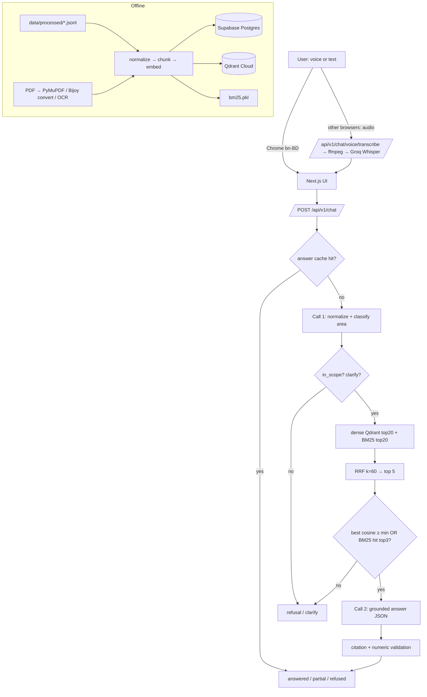

# AdhikarAI — Build Plan

Schedule: 21–23 Nov 2026 to build, 24 Nov morning to polish, then the final demo. MVP comes first. Phases 1–6 are the core and Phases 7–9 make it competitive.
Rules are in `CLAUDE.md` and the spec is `docs/pipeline.md`.

> **Status note (21 Nov):** the team supplied **PDFs** rather than the prepared JSONL: 21 bdlaws.minlaw.gov.bd section-print PDFs of the Labour Act in `data/Workers — Bangladesh Labour Act 2006/` (preamble plus §§ 1–20 and 3ক). Phase 2 therefore gained a PDF → section-JSONL step (`scripts/convert_pdfs.py`, pulled forward from Phase 7), and ingestion runs on that real data. The land, GD and allowance documents haven't arrived yet. In `.env`, Qdrant and Groq are configured but `DATABASE_URL` (Supabase) is still empty.

## Architecture

## API contract

All routes live under `/api/v1`.

| Method | Path | Request | Response |
|---|---|---|---|
| GET | `/health` | — | `{"status":"ok\|degraded","services":{"postgres":{"ok":bool,"detail":str},"qdrant":{...},"groq":{...},"embedding":{...}},"version":str}` |
| POST | `/chat` | `{"message":str(2..2000),"area":"land\|gd\|allowance\|labour"?,"debug":bool=false}` | `{"status":"answered\|partial\|refused\|clarify","answer":str,"citations":[{"chunk_id","act","section","title","citation","excerpt","source_url"}],"normalized_question":str,"area":str,"warnings":[str],"trace":{...}\|null,"latency_ms":int,"cached":bool}` |
| POST | `/chat/voice/transcribe` | multipart `audio` (≤10 MB, ≤30 s) | `{"transcript":str}` |
| POST | `/chat/voice` | multipart `audio` | the `/chat` response plus `"transcript":str` |
| GET | `/sources?area=` | — | `[{"document_id","title","area","source_url","chunk_count"}]` |
| GET | `/sources/documents/{document_id}` | — | `{"document":{...},"chunks":[{"chunk_id","section","title","citation"}]}` |
| GET | `/sources/{chunk_id}` | — | `{"chunk_id","document_id","area","act","chapter","section","title","citation","text","source_url"}` |
| POST | `/feedback` | `{"query_log_id":str,"rating":"up\|down","comment":str?}` | `{"ok":true}` |
| GET | `/eval/latest` | — | contents of `data/evaluation/results.json`, or 404 |

`trace` (only when `debug=true`): `{"candidates":[{"chunk_id","citation","dense_rank","bm25_rank","dense_score","bm25_score","fused_score"}],"best_dense_score":float,"llm_calls":int}`.

## Postgres tables

- **documents:** `id` (pk, slug), `title`, `area`, `issuer`, `source_url`, `source_file`, `language`, `review_status`, `sha256`, `created_at`
- **chunks:** `id` (pk), `document_id` (fk), `area`, `act`, `chapter`, `section`, `title`, `citation`, `part` (int, null when unsplit), `text`, `normalized_text`, `token_count`, `page_start`, `page_end`, `qdrant_point_id` (uuid), `created_at`
- **query_logs:** `id` (uuid), `created_at`, `normalized_question`, `area`, `status`, `retrieved_chunk_ids` (json), `best_dense_score`, `latency_ms`, `llm_calls`, `cached`, `model`. Personal data is not stored: the raw message is kept only if it has fewer than 300 characters and the PII-redaction regex finds no phone or NID number.
- **feedback:** `id`, `query_log_id` (fk), `rating`, `comment`, `created_at`
- **answer_cache:** `key` (sha256 of normalized question + area + model), `response_json`, `created_at`

## Qdrant

Collection `adhikarai_chunks`: vector size `EMBEDDING_DIM` (768), cosine distance. Point ID = `uuid5(NAMESPACE, chunk_id)`. Payload: `chunk_id, area, act, section, citation, document_id`. Payload index: `area` (keyword).

## Env variables (`.env.example`)

`APP_ENV, LOG_LEVEL, CORS_ORIGINS, DATABASE_URL, QDRANT_URL, QDRANT_API_KEY, QDRANT_COLLECTION, GROQ_API_KEY, LLM_MODEL, LLM_TIMEOUT_S, STT_MODEL, EMBEDDING_MODEL, EMBEDDING_DIM, EMBEDDING_DEVICE, RETRIEVAL_MIN_SCORE, BM25_PATH, OCR_PROVIDER, OCR_SECOND_ENGINE, OCR_DEVICE, OCR_MIN_CONFIDENCE`, plus the frontend's `NEXT_PUBLIC_API_URL`.

---

## Phase 1 — Scaffold, config and connection checks (~3 h)

**Goal:** a backend and frontend skeleton that can see Supabase, Qdrant and Groq.
**Files:** `backend/app/{main.py,core/config.py,core/logging.py,core/constants.py,api/routes/health.py,services/health_service.py}`, `backend/requirements.txt`, `backend/pyproject.toml` (ruff and pytest), `backend/tests/unit/test_health.py`, `backend/scripts/check_connections.py`, `frontend/*`, `README.md`, `.gitignore`, `.env.example`, `infra/docker-compose.yml`.

- [x] Python 3.12 venv (uv) and pinned `requirements.txt`
- [x] Settings via pydantic-settings, reading the root `.env`. Secrets use `SecretStr`.
- [x] Structured logging and CORS for `http://localhost:3000`
- [x] `GET /api/v1/health` with per-check timeouts (Postgres `SELECT 1`, Qdrant list collections, Groq `models.list`, embedding lazy status)
- [x] `scripts/check_connections.py` prints OK/FAIL and never prints keys
- [x] Mocked health test
- [x] Next.js, Tailwind and shadcn/ui, Hind Siliguri via next/font, `lang="bn"`, home page showing service status
- [x] README skeleton, `.gitignore`, `.env.example`, offline docker-compose profile

**Test:** `pytest`, `python scripts/check_connections.py`, `uvicorn app.main:app`, `npm run dev`, then open :3000.
**Done when:** check_connections shows OK for all three services (needs `.env`), uvicorn and npm both run, and the home page shows the statuses.

## Phase 2 — Ingest the existing JSONL (~3 h)

**Goal:** `all_documents.jsonl` loaded into Postgres, Qdrant and BM25, idempotently.
**Files:** `app/db/{base.py,session.py,models.py}`, `app/ingestion/{text_normalizer.py,area_map.py,jsonl_loader.py,chunker.py,embedder.py,indexer.py}`, `app/repositories/{qdrant_repository.py,bm25_repository.py}`, `scripts/{create_tables.py,ingest_jsonl.py}`, tests.

- [x] SQLAlchemy models and the `create_tables` script
- [x] Explicit source registry (`area_map.py`: PDF folder / JSONL `source_file` → document and area), which fails loudly on unknown sources
- [x] Bangla normalizer (NFC, nukta forms, য়, legacy danda `৷`, whitespace, digit map) and BM25 tokenizer
- [x] **Added:** bdlaws PDF parser (`pdf_parser.py` rebuilds visual rows that PyMuPDF splits mid-word, and `bdlaws_parser.py` handles margin titles, chapter, footnotes → `notes`, source URL) plus `text_repair.py` (doubled vowel signs, Bijoy leftovers, stray in-word spaces), with rules from the real corpus
- [x] Section-aware chunker (≤450 e5 tokens kept whole; longer sections packed from whole clauses, sentence split only for an overlong clause, ~60-token overlap, part numbers)
- [x] e5 embedder (passage prefix, GPU batch size, CPU fallback)
- [x] Qdrant collection, area payload index, deterministic UUIDv5 upserts in batches, stale-point cleanup
- [x] BM25 pickle with chunk-ID order and chunk metadata (offline fallback for citations)
- [x] `ingest_jsonl.py`: idempotent, prints counts per area and timing, checks counts match across stores (`--skip-postgres` until Supabase is set)
- [x] Tests: chunker, normalizer, tokenizer, text repair, deterministic IDs, BM25 round trip, parser regression on real PDFs
- [x] Real run on the Labour Act PDFs: 22 sections → 55 chunks; two runs give identical counts (Qdrant 55 = BM25 55)
- [ ] Postgres write (`create_tables.py`, then `ingest_jsonl.py` without `--skip-postgres`). **Blocked:** `DATABASE_URL` is empty.

**Test:** `pytest tests/unit`, then `python scripts/ingest_jsonl.py` twice.
**Done when:** two runs give identical counts, the Postgres, Qdrant and BM25 counts are equal, and the Bangla sample text reads correctly.

## Phase 3 — Hybrid retrieval (~2 h)

**Goal:** dense + BM25 + RRF, with traces kept for the UI.
**Files:** `app/services/{retrieval_service.py,fusion_service.py}`, `scripts/{try_retrieval.py,eval_retrieval.py}`, `data/evaluation/retrieval_seed.jsonl`, tests.

- [ ] Dense top 20 (query prefix, optional area filter) and BM25 top 20, each returning (chunk_id, score, rank)
- [ ] RRF top 5 with dense rank, BM25 rank, cosine and fused score
- [ ] A section-number query (`ধারা ১২৩` / `section 123`) is hit by BM25 (test)
- [ ] `try_retrieval.py` CLI
- [ ] Seed file template: 8 questions, expected IDs left empty for a human
- [ ] `eval_retrieval.py`: Recall@5 and MRR for dense, BM25 and hybrid, saved as JSON
- [ ] Fill in the expected IDs and run on real data (blocked: data)

**Done when:** try_retrieval works for one question per area and eval runs on the seed file.

## Phase 4 — LLM orchestration and `/chat` (~4 h)

**Goal:** the full grounded-answer pipeline with refusal, validation and cache.
**Files:** `app/models/llm_client.py`, `app/prompts/{normalize.md,answer_bn.md}`, `app/services/{query_normalizer.py,trust_policy.py,generation_service.py,citation_validator.py,answer_cache.py,orchestrator.py}`, `app/schemas/{chat.py,llm.py,source.py,feedback.py}`, `app/api/routes/{chat.py,sources.py,feedback.py}`, `scripts/test_llm_models.py`, tests.

- [ ] Groq wrapper: async, JSON mode, temperature 0.1, timeout, backoff on 429/5xx (max 3), token-usage logs
- [ ] `test_llm_models.py`, a side-by-side comparison for choosing `LLM_MODEL`
- [ ] Call 1 normalizer with a Pydantic schema
- [ ] Trust gate: out of scope → refusal, clarify → question, low score and no BM25 hit in the top 3 → refusal
- [ ] Call 2 generator (max ~120 words, numbered steps, exact numbers, `found`)
- [ ] Validator: drops unknown IDs, refuses on empty or not found, and marks a numeric mismatch as `partial` with a warning
- [ ] Orchestrator, `/chat`, answer cache, query logging, `/sources`, `/feedback`
- [ ] Mocked tests: refusal paths, invalid ID dropped, numeric mismatch, clarify, cache hit
- [ ] Choose `LLM_MODEL` with `test_llm_models.py` (needs the Groq key)

**Done when:** the README curl examples return a cited answer per area, and an off-topic question returns the exact refusal.

## Phase 5 — Frontend (~5 h)

**Goal:** a calm, trustworthy Bangla UI wired to `/chat`.
**Files:** `frontend/app/{page.tsx,sources/page.tsx,about/page.tsx,layout.tsx,globals.css}`, `frontend/components/*`, `frontend/lib/{api.ts,types.ts,areas.ts,bn.ts}`.

- [ ] Design tokens (deep green accent, warm gray, status colors), Hind Siliguri at 17–18px with 1.7 line height
- [ ] Header, empty state with four area cards and example chips, fixed composer with mic button
- [ ] Answer card: status badge, numbered steps, `[১]` markers, সূত্র list, copy and feedback buttons
- [ ] Citation side sheet (bottom sheet on mobile) with an "মূল উৎস দেখুন" link
- [ ] Refusal card with a `tel:333` button, plus the "কীভাবে পাওয়া গেল" trace panel
- [ ] Skeleton loading state, Bangla errors with retry, disclaimer
- [ ] `/sources` and `/about` pages
- [ ] Accessibility: aria-live, focus rings, reduced motion

**Done when:** one question per area works from the UI, and the layout is right at 360px and 1440px.

## Phase 6 — Voice input (~2 h)

- [ ] `useSpeechInput` hook (bn-BD, interim text, edit before sending, Bangla error messages)
- [ ] MediaRecorder fallback (30 s) → `/chat/voice/transcribe`
- [ ] Backend transcribe endpoint (ffmpeg 16 kHz mono, Whisper with domain prompt, temp files deleted) and `/chat/voice`
- [ ] Tests with Groq mocked and a generated WAV

**Done when:** speaking in Chrome works, and the Firefox recording fallback works.

## Phase 7 — PDF, legacy font and local OCR (~4 h)

- [ ] PyMuPDF page parser and page classifier (text, legacy font, scanned)
- [ ] Bijoy → Unicode converter, post-fix rules and unit tests
- [ ] OCR service (Tesseract, then a second engine when confidence is below the minimum, confidence per page, GPU freed before embedding)
- [ ] `compare_ocr.py` and `ingest_pdf.py` (reusing the Phase 2 code)
- [ ] Install Tesseract with `ben` (`sudo dnf install tesseract tesseract-langpack-ben`) and run it on real PDFs

**Done when:** a text PDF, a legacy-font PDF and a scanned page all ingest and are searchable.

## Phase 8 — Evaluation (~3 h)

- [ ] `gold.jsonl` template (questions only; the human fills in expected fields)
- [ ] `run_eval.py`: Recall@5, MRR, citation validity, refusal rate, false-answer rate, must_include coverage, p50/p95 latency, dense-vs-hybrid ablation, checkpoint and resume, throttling
- [ ] Threshold trade-off table for `RETRIEVAL_MIN_SCORE`
- [ ] `GET /api/v1/eval/latest` and the মূল্যায়ন table on `/about`

**Done when:** run_eval completes on the filled gold set and `/about` shows the table.

## Phase 9 — Demo polish (24 Nov morning)

- [ ] README: setup, run, ingest, test, eval and credits
- [ ] `scripts/warmup.py` (wakes the databases, loads e5, pre-caches the demo questions)
- [ ] `docs/demo_script.md` (3 minutes)
- [ ] Offline fallback documented
- [ ] Final QA on real data: tests, ruff, `npm run build`, 360px check, `git grep` for keys

---

## Risks and mitigations

| Risk | Mitigation |
|---|---|
| Groq 429 or model retirement | Backoff (max 3), answer cache, warm-up pre-cache of demo questions, `LLM_MODEL` in env, and teammates' own Groq accounts as spare keys |
| Supabase or Qdrant paused after inactivity | `warmup.py` the day before and the morning of the demo; offline docker profile |
| Weak venue internet | Offline profile (local Postgres and Qdrant), pre-cached answers, phone hotspot. Browser STT also needs internet, so the text box stays usable. |
| Whisper weak on Bangla | Browser bn-BD is the default, Whisper only a fallback with a domain-word prompt, and the transcript is always editable |
| OCR quality on scanned Bangla | Look for a text copy first, try Tesseract then a second engine, compare with `compare_ocr.py`, and mark low-confidence pages `needs_review` |
| Dataset arrives late or as PDFs | Phase 7 pipeline is ready; ingestion code is shared |
| Hallucinated numbers | Numeric validator marks the answer `partial` with a warning, and citations come only from stored metadata |

## Cut list (drop in this order if time runs short)

1. `/sources` browse page (keep the citation sheet)
2. Eval table in the UI (keep the CLI results)
3. Second OCR engine (Tesseract only)
4. Whisper fallback (Chrome only, demoed in Chrome)
5. Legacy-font conversion for new PDFs (use the prepared JSONL)
6. Answer cache in Postgres (switch to an in-memory LRU)

## Known limitations

- The dataset hasn't been supplied yet, so no real retrieval or answer numbers exist.
