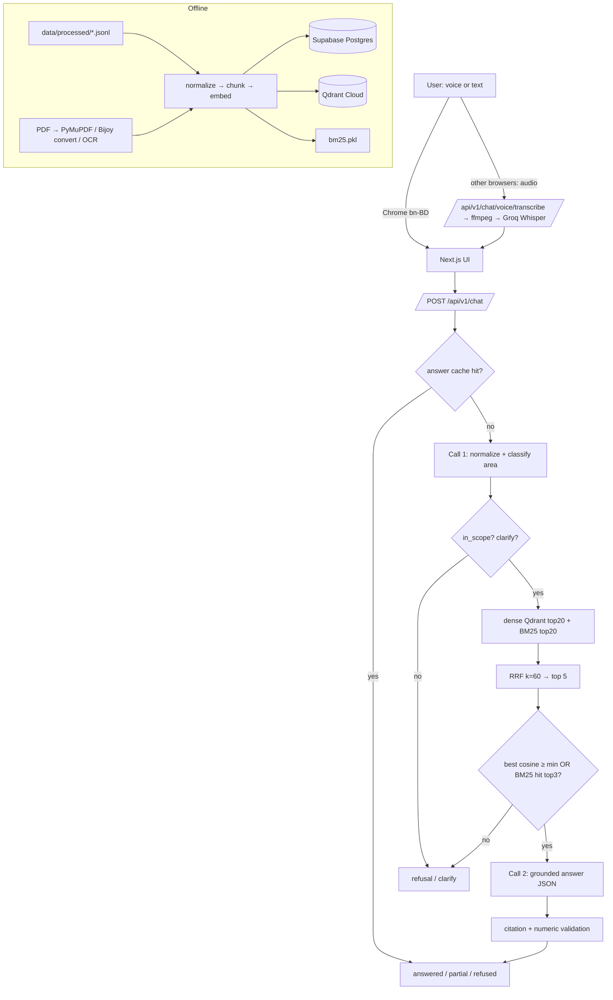

# AdhikarAI — Build Plan

Schedule: 21–23 Nov 2026 to build, 24 Nov morning to polish, then the final demo. MVP comes first. Phases 1–6 are the core and Phases 7–9 make it competitive.
Rules are in `CLAUDE.md` and the spec is `docs/pipeline.md`.

> **Status note (21 Nov):** the team supplied **PDFs** rather than the prepared JSONL: 21 bdlaws.minlaw.gov.bd section-print PDFs of the Labour Act in `data/Workers — Bangladesh Labour Act 2006/` (preamble plus §§ 1–20 and 3ক). Phase 2 therefore gained a PDF → section-JSONL step (`scripts/convert_pdfs.py`, pulled forward from Phase 7), and ingestion runs on that real data. The land, GD and allowance documents haven't arrived yet. `.env` now has Supabase, Qdrant and Groq (all three connection checks OK). `LLM_MODEL` is still unset (recommended: `openai/gpt-oss-20b`). Phases 1–7 are complete. Phases 8–9 are built and the remaining items are human tasks: labelling the gold set, setting `LLM_MODEL`, warm-up, rehearsal and the other areas' documents.

## Architecture

## API contract

All routes live under `/api/v1`.

| Method | Path | Request | Response |
|---|---|---|---|
| GET | `/health` | — | `{"status":"ok\|degraded","services":{"postgres":{"ok":bool,"detail":str},"qdrant":{...},"groq":{...},"embedding":{...}},"version":str}` |
| POST | `/chat` | `{"message":str(2..2000),"area":"land\|gd\|allowance\|labour"?,"debug":bool=false}` | `{"status":"answered\|partial\|refused\|clarify","answer":str,"citations":[{"chunk_id","act","section","title","citation","excerpt","source_url"}],"normalized_question":str,"area":str,"warnings":[str],"trace":{...}\|null,"latency_ms":int,"cached":bool}` |
| POST | `/chat/voice/transcribe` | multipart `audio` (≤10 MB, ≤30 s) | `{"transcript":str}` |
| POST | `/chat/voice` | multipart `audio` | the `/chat` response plus `"transcript":str` |
| GET | `/sources?area=` | — | `[{"document_id","title","area","source_url","chunk_count"}]` |
| GET | `/sources/documents/{document_id}` | — | `{"document":{...},"chunks":[{"chunk_id","section","title","citation"}]}` |
| GET | `/sources/{chunk_id}` | — | `{"chunk_id","document_id","area","act","chapter","section","title","citation","text","source_url"}` |
| POST | `/feedback` | `{"query_log_id":str,"rating":"up\|down","comment":str?}` | `{"ok":true}` |
| GET | `/eval/latest` | — | contents of `data/evaluation/results.json`, or 404 |

Each `/chat` response also carries `request_id` (pass it to `/feedback`). Citations also carry `marker` (the number shown as `[১]` in the answer) and `notes` (amendment footnotes). Errors: HTTP 503 `{"detail":{"code":"rate_limited|llm_not_configured|llm_unavailable|index_missing","message":"<Bangla>"}}`.

`trace` (only when `debug=true`): `{"candidates":[{"chunk_id","citation","title","dense_rank","bm25_rank","dense_score","bm25_score","fused_score","exact_section"}],"best_dense_score":float,"llm_calls":int,"model":str,"gate":str}`.

## Postgres tables

- **documents:** `id` (pk, slug), `title`, `area`, `issuer`, `source_url`, `source_file`, `language`, `review_status`, `sha256`, `created_at`
- **chunks:** `id` (pk), `document_id` (fk), `area`, `act`, `chapter`, `section`, `title`, `citation`, `part` (int, null when unsplit), `text`, `normalized_text`, `token_count`, `page_start`, `page_end`, `qdrant_point_id` (uuid), `created_at`
- **query_logs:** `id` (uuid), `created_at`, `normalized_question`, `area`, `status`, `retrieved_chunk_ids` (json), `best_dense_score`, `latency_ms`, `llm_calls`, `cached`, `model`. Personal data is not stored: the raw message is kept only if it has fewer than 300 characters and the PII-redaction regex finds no phone or NID number.
- **feedback:** `id`, `query_log_id` (fk), `rating`, `comment`, `created_at`
- **answer_cache:** `key` (sha256 of normalized question + area + model), `response_json`, `created_at`

## Qdrant

Collection `adhikarai_chunks`: vector size `EMBEDDING_DIM` (768), cosine distance. Point ID = `uuid5(NAMESPACE, chunk_id)`. Payload: `chunk_id, area, act, section, citation, document_id`. Payload index: `area` (keyword).

## Env variables (`.env.example`)

`APP_ENV, LOG_LEVEL, CORS_ORIGINS, DATABASE_URL, QDRANT_URL, QDRANT_API_KEY, QDRANT_COLLECTION, GROQ_API_KEY, LLM_MODEL, LLM_TIMEOUT_S, STT_MODEL, EMBEDDING_MODEL, EMBEDDING_DIM, EMBEDDING_DEVICE, RETRIEVAL_MIN_SCORE, BM25_PATH, OCR_PROVIDER, OCR_SECOND_ENGINE, OCR_DEVICE, OCR_MIN_CONFIDENCE`, plus the frontend's `NEXT_PUBLIC_API_URL`.

---

## Phase 1 — Scaffold, config and connection checks (~3 h)

**Goal:** a backend and frontend skeleton that can see Supabase, Qdrant and Groq.
**Files:** `backend/app/{main.py,core/config.py,core/logging.py,core/constants.py,api/routes/health.py,services/health_service.py}`, `backend/requirements.txt`, `backend/pyproject.toml` (ruff and pytest), `backend/tests/unit/test_health.py`, `backend/scripts/check_connections.py`, `frontend/*`, `README.md`, `.gitignore`, `.env.example`, `infra/docker-compose.yml`.

- [x] Python 3.12 venv (uv) and pinned `requirements.txt`
- [x] Settings via pydantic-settings, reading the root `.env`. Secrets use `SecretStr`.
- [x] Structured logging and CORS for `http://localhost:3000`
- [x] `GET /api/v1/health` with per-check timeouts (Postgres `SELECT 1`, Qdrant list collections, Groq `models.list`, embedding lazy status)
- [x] `scripts/check_connections.py` prints OK/FAIL and never prints keys
- [x] Mocked health test
- [x] Next.js, Tailwind and shadcn/ui, Hind Siliguri via next/font, `lang="bn"`, home page showing service status
- [x] README skeleton, `.gitignore`, `.env.example`, offline docker-compose profile

**Test:** `pytest`, `python scripts/check_connections.py`, `uvicorn app.main:app`, `npm run dev`, then open :3000.
**Done when:** check_connections shows OK for all three services (needs `.env`), uvicorn and npm both run, and the home page shows the statuses.

## Phase 2 — Ingest the existing JSONL (~3 h)

**Goal:** `all_documents.jsonl` loaded into Postgres, Qdrant and BM25, idempotently.
**Files:** `app/db/{base.py,session.py,models.py}`, `app/ingestion/{text_normalizer.py,area_map.py,jsonl_loader.py,chunker.py,embedder.py,indexer.py}`, `app/repositories/{qdrant_repository.py,bm25_repository.py}`, `scripts/{create_tables.py,ingest_jsonl.py}`, tests.

- [x] SQLAlchemy models and the `create_tables` script
- [x] Explicit source registry (`area_map.py`: PDF folder / JSONL `source_file` → document and area), which fails loudly on unknown sources
- [x] Bangla normalizer (NFC, nukta forms, য়, legacy danda `৷`, whitespace, digit map) and BM25 tokenizer
- [x] **Added:** bdlaws PDF parser (`pdf_parser.py` rebuilds visual rows that PyMuPDF splits mid-word, and `bdlaws_parser.py` handles margin titles, chapter, footnotes → `notes`, source URL) plus `text_repair.py` (doubled vowel signs, Bijoy leftovers, stray in-word spaces), with rules from the real corpus
- [x] Section-aware chunker (≤450 e5 tokens kept whole; longer sections packed from whole clauses, sentence split only for an overlong clause, ~60-token overlap, part numbers)
- [x] e5 embedder (passage prefix, GPU batch size, CPU fallback)
- [x] Qdrant collection, area payload index, deterministic UUIDv5 upserts in batches, stale-point cleanup
- [x] BM25 pickle with chunk-ID order and chunk metadata (offline fallback for citations)
- [x] `ingest_jsonl.py`: idempotent, prints counts per area and timing, checks counts match across stores (`--skip-postgres` until Supabase is set)
- [x] Tests: chunker, normalizer, tokenizer, text repair, deterministic IDs, BM25 round trip, parser regression on real PDFs
- [x] Real run on the Labour Act PDFs: 22 sections → 55 chunks; two runs give identical counts (Qdrant 55 = BM25 55)
- [x] Postgres write: tables created, two full runs with matching counts `{'chunks': 55, 'qdrant': 55, 'bm25': 55, 'postgres': 55}`

**Test:** `pytest tests/unit`, then `python scripts/ingest_jsonl.py` twice.
**Done when:** two runs give identical counts, the Postgres, Qdrant and BM25 counts are equal, and the Bangla sample text reads correctly.

## Phase 3 — Hybrid retrieval (~2 h)

**Goal:** dense + BM25 + RRF, with traces kept for the UI.
**Files:** `app/services/{retrieval_service.py,fusion_service.py}`, `scripts/{try_retrieval.py,eval_retrieval.py}`, `data/evaluation/retrieval_seed.jsonl`, tests.

- [x] Dense top 20 (query prefix, optional area filter) and BM25 top 20, each returning (chunk_id, score, rank)
- [x] RRF top 5 with dense rank, BM25 rank, cosine and fused score
- [x] A section-number query (`ধারা ১২৩` / `section 123` / `৩ক ধারা`) is hit: exact matches go to the top of BM25 and form a third RRF list (tests, plus a real check that `ধারা ১৯` ranks first)
- [x] `try_retrieval.py` CLI (`--area`, `--mode hybrid|dense|bm25`)
- [x] Seed file template: 8 questions, expected IDs left empty for a human
- [x] `eval_retrieval.py`: Recall@5 and MRR for dense, BM25 and hybrid, saved as JSON
- [ ] Fill in `expected_chunk_ids` in `data/evaluation/retrieval_seed.jsonl` (human task; section IDs like `labour-act-2006-s4` work), then run the evaluation. Only the 2 labour rows can score until the other areas' documents arrive.

> **Finding (21 Nov):** dense cosine barely separates on-topic (≈0.79–0.83) from off-topic (≈0.75–0.81) questions, and "BM25 hit in the top 3" is almost always true. The score gate alone will refuse little, so refusals rely on Call 1 `in_scope`, Call 2 `found=false` and validation. Tune `RETRIEVAL_MIN_SCORE` in Phase 8.

**Done when:** try_retrieval works for one question per area and eval runs on the seed file.

## Phase 4 — LLM orchestration and `/chat` (~4 h)

**Goal:** the full grounded-answer pipeline with refusal, validation and cache.
**Files:** `app/models/llm_client.py`, `app/prompts/{normalize.md,answer_bn.md}`, `app/services/{query_normalizer.py,trust_policy.py,generation_service.py,citation_validator.py,answer_cache.py,orchestrator.py}`, `app/schemas/{chat.py,llm.py,source.py,feedback.py}`, `app/api/routes/{chat.py,sources.py,feedback.py}`, `scripts/test_llm_models.py`, tests.

- [x] Groq wrapper: async, JSON mode, temperature 0.1, timeout, backoff on 429/5xx (max 3), token-usage logs
- [x] `test_llm_models.py`, a side-by-side comparison for choosing `LLM_MODEL`
- [x] Call 1 normalizer with a Pydantic schema
- [x] Trust gate: out of scope → refusal, clarify → question, low score and no BM25 hit in the top 3 → refusal
- [x] Call 2 generator (max ~120 words, numbered steps, exact numbers, `found`)
- [x] Validator: drops unknown IDs, refuses on empty or not found, and marks a numeric mismatch as `partial` with a warning
- [x] Orchestrator, `/chat`, answer cache, query logging, `/sources`, `/feedback`
- [x] Mocked tests: refusal paths, invalid ID dropped, numeric mismatch, clarify, cache hit
- [x] Model comparison run (`test_llm_models.py ... --with-answer`) on gpt-oss-120b, gpt-oss-20b and qwen3.8-27b. **Recommended: `openai/gpt-oss-20b`** (correct dialect and Banglish normalization, faithful numbers, about 1.5 s for both calls). 120b flipped a dialect question's meaning; qwen changed a Banglish question's meaning and rewrote numbers.
- [ ] Set `LLM_MODEL=openai/gpt-oss-20b` in `.env` (team decision)
- [x] Verified end to end with curl: labour question answered with §11/§20 citations, the repeat served from cache in 0 ms, off-topic and land questions refused with the exact text.

> Free-tier note: each answered question costs about 2.5k tokens, mostly Bangla source text. Groq TPM limits caused 10–20 s spikes in back-to-back tests, so warm the cache for demo questions (Phase 9).

**Done when:** the README curl examples return a cited answer per area, and an off-topic question returns the exact refusal.

## Phase 5 — Frontend (~5 h)

**Goal:** a calm, trustworthy Bangla UI wired to `/chat`.
**Files:** `frontend/app/{page.tsx,sources/page.tsx,about/page.tsx,layout.tsx,globals.css}`, `frontend/components/*`, `frontend/lib/{api.ts,types.ts,areas.ts,bn.ts}`.

- [x] Design tokens (deep green accent, warm gray, status colors), Hind Siliguri at 17–18px with 1.7 line height
- [x] Header, empty state with four area cards and example chips, fixed composer with mic button
- [x] Answer card: status badge, numbered steps, `[১]` markers, সূত্র list, copy and feedback buttons
- [x] Citation side sheet (bottom sheet on mobile) with an "মূল উৎস দেখুন" link
- [x] Refusal card with a `tel:333` button, plus the "কীভাবে পাওয়া গেল" trace panel
- [x] Skeleton loading state, Bangla errors with retry, disclaimer
- [x] `/sources` and `/about` pages
- [x] Accessibility: aria-live, focus rings, reduced motion

**Done when:** one question per area works from the UI, and the layout is right at 360px and 1440px.

> Verified 21 Nov with headless Chromium (Playwright) against the live API: home, answer, trace, citation sheet (side on desktop, bottom on mobile), refusal card with `tel:333`, `/sources` and `/about` at 360 and 1440 px. No horizontal overflow and no console errors. Only labour can be demonstrated so far; the other three areas correctly refuse until their documents are ingested.

## Phase 6 — Voice input (~2 h)

- [x] `useSpeechInput` hook (bn-BD, interim text, edit before sending, Bangla error messages)
- [x] MediaRecorder fallback (30 s) → `/chat/voice/transcribe`
- [x] Backend transcribe endpoint (ffmpeg 16 kHz mono, Whisper with domain prompt, temp files deleted) and `/chat/voice`
- [x] Tests with Groq mocked and a generated WAV

- [x] **Added:** silence check (ffmpeg volumedetect) and a prompt-echo guard. A real Whisper call turned a pure test tone into "প্রতিবন্ধী ভাতা", a word from the domain prompt, so such transcripts are discarded.
- [ ] Real-microphone check in Chrome and Firefox (human task: speak a dialect question, edit, send)

**Done when:** speaking in Chrome works, and the Firefox recording fallback works.

> Verified 21 Nov in headless Chromium: the speech path (scripted recognizer) shows interim text and puts the final text in the input without sending. The recorder path (fake mic, no SpeechRecognition) goes upload → ffmpeg → real Groq Whisper → prompt echo discarded → Bangla "couldn't understand" message. No page errors.

## Phase 7 — PDF, legacy font and local OCR (~4 h)

- [x] PyMuPDF page parser (Phase 2 row rebuild) and page classifier (text, legacy font, scanned). The classifier was tightened after a test showed plain English pages being taken for Bijoy.
- [x] Bijoy → Unicode converter (longest-match table, pre-base vowel and reph reordering, NFC, post-fix rules) with known-pair tests (`eq¯‹fvZv` → `বয়স্কভাতা` and others). It reports unmapped glyphs; pages over 2% unmapped go to OCR or review. **The table is core-only; spot-check against a real legacy PDF.**
- [x] OCR service (Tesseract `ben+eng`, then EasyOCR when confidence is below the minimum; engine and confidence per page; `needs_review`; `release()` frees the GPU before embedding). The Surya and PaddleOCR adapters are left unwired until `compare_ocr.py` shows one is worth it.
- [x] `compare_ocr.py` and `ingest_pdf.py` (auto-detects bdlaws vs generic; preserves originals in `data/originals/<area>/` with sha256; `data/sources_log.csv` and `data/sources_registry.json`; reuses the Phase 2 pipeline via `app/ingestion/pipeline.py`)
- [ ] Install Tesseract with `ben` (`sudo dnf install tesseract tesseract-langpack-ben`) and optionally `uv pip install easyocr`, then run `compare_ocr.py` on 3–5 real scanned pages (human task, needs sudo)
- [ ] Ingest real land, GD and allowance PDFs with `ingest_pdf.py` (blocked: documents not supplied yet)

**Done when:** a text PDF, a legacy-font PDF and a scanned page all ingest and are searchable.

## Phase 8 — Evaluation (~3 h)

- [x] `gold.jsonl` template: 24 questions (11 labour, 3 land, 3 GD, 3 allowance, 4 off-topic; standard, dialect, Banglish and English variants). Questions only; expected fields left empty.
- [x] `run_eval.py`: Recall@5, MRR, citation validity, refusal rate, false-answer rate, must_include coverage, area-detection accuracy, p50/p95 latency, dense-vs-BM25-vs-hybrid ablation, checkpoint and resume, throttling (`--sleep`, default 15 s), DB logging off, fresh cache
- [x] Threshold trade-off table for `RETRIEVAL_MIN_SCORE` (printed and saved; not applied automatically)
- [x] `GET /api/v1/eval/latest` and the মূল্যায়ন table on `/about` (shows only measured numbers and sample counts, "—" where unlabelled)
- [x] **Fixes found by the evaluation** (each with a regression test):
  - `ধারা ১৯ এ কী বলা আছে?` was refused as out of scope → normalize prompt now covers "what does section N say", and a known area with `in_scope=false` continues to retrieval
  - Banglish service-book question was misclassified as land and found no documents → domain terms added to the prompt, plus a fallback to all areas when the classified area has no candidates
  - "section 4 … probation" got `found=false` despite perfect retrieval → Call 1 maps everyday and English words to statutory Bangla terms (probation → শিক্ষানবিশীকাল), and Call 2 matches by meaning
  - false `partial`: the source says `০৬`, the answer said `৬` → numbers compared by value
  - false `partial`: the source says `আট কিলোমিটার` (in words), the answer said `৮ কিমি` → the validator reads common Bangla number words in the source (fixed after the final run)
- [ ] Fill in `expected_chunk_ids`, `must_include` and `must_not_include` in `data/evaluation/gold.jsonl` (human task), then run `run_eval.py` again to get Recall@5, MRR and coverage
- [x] Rerun with 15 s spacing (21 Nov). Results are below and in `data/evaluation/results.json`.

**Measured (21 Nov, `openai/gpt-oss-20b`, 24 questions, 15 s spacing; `data/evaluation/results.json`):**

| Metric | Result | n |
|---|---|---|
| Labour questions answered | 11/11 (10 answered, 1 partial*) | 11 |
| Land, GD and allowance questions refused (no documents yet) | 9/9, no false answers | 9 |
| Off-topic correctly refused | 100% | 4 |
| False-answer rate | 0% | 4 |
| Area detection | 100% | 20 |
| Citation validity | 100% | 15 |
| Latency p50 / p95 | 2.4 s / 4.6 s | 24 |
| Recall@5, MRR, must_include coverage | n/a (gold set unlabelled) | 0 |

\* The one `partial` was a validator false positive (`আট` vs `৮`), fixed after the run. With 3 s spacing the same run measured p50 17.7 s / p95 24.8 s, because of Groq free-tier TPM throttling. Score-gate trade-off: at 0.80 the gate alone blocks 3/4 off-topic questions (Call 1 already refuses all 4).

**Done when:** run_eval completes on the filled gold set and `/about` shows the table. (`/about` shows the table now; the gold set still needs labels.)

## Phase 9 — Demo polish (24 Nov morning)

- [x] README: what it is, architecture, setup in about 10 commands, env table, adding documents, tests and evaluation, API, demo day, offline fallback, credits (data source URLs, models, services, libraries, dev tools, Claude Code)
- [x] `scripts/warmup.py` (wakes Supabase and Qdrant, loads e5, pre-caches the `- Q…:` questions from `docs/demo_script.md` with the real pipeline, 15 s apart). Written and lint-checked; **not run yet** (needs `LLM_MODEL` in `.env`).
- [x] `docs/demo_script.md` (3 minutes). The opener is lay-off compensation in dialect, because the wage-payment chapter for the planned "unpaid wages" question isn't ingested.
- [x] Offline fallback documented (README → Demo day). Not rehearsed with Docker yet.
- [x] QA so far: 109 backend tests pass, ruff clean, `npm run lint` and `npm run build` pass, 360/1440 px screenshots checked in Phase 5, secret scan of tracked files and API logs clean, `.env` untracked
- [ ] Set `LLM_MODEL=openai/gpt-oss-20b` in `.env`, run `warmup.py` the day before and the morning of the demo
- [ ] Rehearse the demo in Chrome with a real microphone; rehearse the offline profile once
- [ ] Final QA after the remaining documents are ingested

---

## Risks and mitigations

| Risk | Mitigation |
|---|---|
| Groq 429 or model retirement | Backoff (max 3), answer cache, warm-up pre-cache of demo questions, `LLM_MODEL` in env, and teammates' own Groq accounts as spare keys |
| Supabase or Qdrant paused after inactivity | `warmup.py` the day before and the morning of the demo; offline docker profile |
| Weak venue internet | Offline profile (local Postgres and Qdrant), pre-cached answers, phone hotspot. Browser STT also needs internet, so the text box stays usable. |
| Whisper weak on Bangla | Browser bn-BD is the default, Whisper only a fallback with a domain-word prompt, and the transcript is always editable |
| OCR quality on scanned Bangla | Look for a text copy first, try Tesseract then a second engine, compare with `compare_ocr.py`, and mark low-confidence pages `needs_review` |
| Dataset arrives late or as PDFs | Phase 7 pipeline is ready; ingestion code is shared |
| Hallucinated numbers | Numeric validator marks the answer `partial` with a warning, and citations come only from stored metadata |

## Cut list (drop in this order if time runs short)

1. `/sources` browse page (keep the citation sheet)
2. Eval table in the UI (keep the CLI results)
3. Second OCR engine (Tesseract only)
4. Whisper fallback (Chrome only, demoed in Chrome)
5. Legacy-font conversion for new PDFs (use the prepared JSONL)
6. Answer cache in Postgres (switch to an in-memory LRU)

## Known limitations

- Only the Bangladesh Labour Act 2006 (preamble, §§ 1–20) is ingested. Land, GD and allowance questions are refused until their documents are added, and the wage-payment chapter is missing.
- The gold set is unlabelled, so Recall@5, MRR and answer coverage aren't measured yet.
- The Groq free tier throttles at a few answers per minute (≈2.5k tokens each). Back-to-back questions take 15–25 s; rely on the cache and warm-up.
- The Bijoy converter table is core-only and untested on a real legacy-font PDF. Tesseract isn't installed on the dev laptop; the Surya and PaddleOCR adapters aren't wired.
- A few glyphs are missing from the bdlaws PDF text layer (e.g. `ং` after some conjuncts: `প্রিন্টি প্রেস`), and some source pages carry their own legacy typos (`পরবতী`). These are kept as in the source.
- Voice input was checked with a scripted recognizer and Chromium's fake microphone, not yet with a real microphone.
