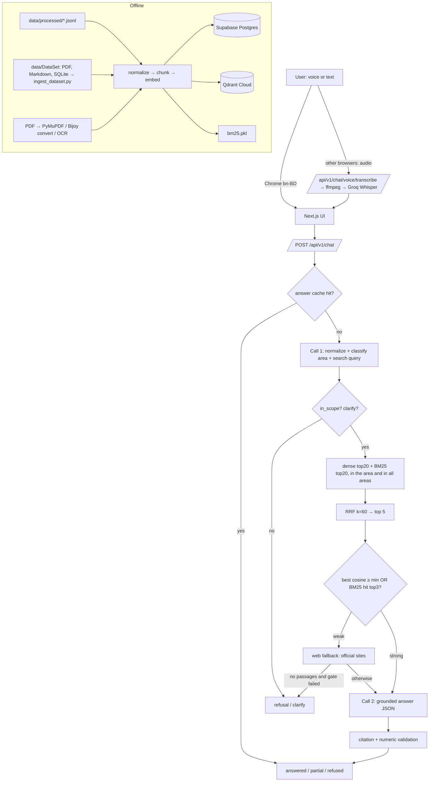

# AdhikarAI — Build Plan

Schedule: 21–23 Nov 2026 to build, 24 Nov morning to polish, then the final demo. MVP comes first. Phases 1–6 are the core and Phases 7–9 make it competitive.
Rules are in `CLAUDE.md` and the spec is `docs/pipeline.md`.

> **Status (22 Nov): built and ingested, not yet demo-ready.** Phases 1–11 are built. The full DataSet is live (1,927 documents, 73,805 chunks, equal in all three stores). 181 backend tests pass (2 skipped); ruff, frontend lint and build are clean. Manual checks on the full corpus found wrong-source answers. **Phase 12 is the work left before 24 Nov.**
>
> Phases 1–10 below are kept as a build log, so their notes, counts and results describe the corpus on the day they were written (55 chunks, Labour Act §§ 1–20).

## Architecture

## API contract

All routes live under `/api/v1`.

| Method | Path | Request | Response |
|---|---|---|---|
| GET | `/health` | — | `{"status":"ok\|degraded","services":{"postgres":{"ok":bool,"detail":str},"qdrant":{...},"groq":{...},"embedding":{...}},"version":str}` |
| POST | `/chat` | `{"message":str(2..2000),"area":"land\|gd\|allowance\|labour\|general"?,"debug":bool=false,"user_doc_id":str?}` | `{"status":"answered\|partial\|refused\|clarify","answer":str,"citations":[{"chunk_id","act","section","title","citation","excerpt","source_url"}],"normalized_question":str,"area":str,"warnings":[str],"trace":{...}\|null,"latency_ms":int,"cached":bool}` |
| POST | `/chat/voice/transcribe` | multipart `audio` (≤10 MB, ≤30 s) | `{"transcript":str}` |
| POST | `/chat/voice` | multipart `audio` | the `/chat` response plus `"transcript":str` |
| POST | `/tts` | `{"text":str,"token":str}` (an answer and its `speech_token`) | `{"audio_url":str,"cached":bool,"chars":int}`; 403 if not signed, 503 `tts_disabled` |
| GET | `/tts/{key}.mp3` | — | `audio/mpeg` (streamed from ElevenLabs the first time, then from `data/tts_cache/`); 404 unknown key, 503 `tts_quota`/`tts_unavailable` |
| GET | `/sources?area=&q=&page=&page_size=` | — | `{"items":[{"document_id","title","area","issuer","source_url","section_count","chunk_count"}],"total","page","page_size","pages","counts"}` |
| GET | `/sources/documents/{document_id}` | — | `{"document":{...},"chunks":[{"chunk_id","section","title","citation"}]}` |
| GET | `/sources/{chunk_id}` | — | `{"chunk_id","document_id","area","act","chapter","section","title","citation","text","source_url"}` |
| POST | `/feedback` | `{"query_log_id":str,"rating":"up\|down","comment":str?}` | `{"ok":true,"stored":bool}` |
| GET | `/eval/latest` | — | contents of `data/evaluation/results.json`, or 404 |

The admin and `/user-docs` routes are listed in `README.md` → API. Citations have `kind` = official, user or web.

Each `/chat` response also carries `request_id` (pass it to `/feedback`) and `speech_token` (for `/tts`; null for personal-document answers or when TTS is off). Citations also carry `marker` (the number shown as `[১]` in the answer) and `notes` (amendment footnotes). Errors: HTTP 503 `{"detail":{"code":"rate_limited|llm_not_configured|llm_unavailable|index_missing","message":"<Bangla>"}}`.

`trace` (only when `debug=true`): `{"candidates":[{"chunk_id","citation","title","dense_rank","bm25_rank","dense_score","bm25_score","fused_score","exact_section"}],"best_dense_score":float,"llm_calls":int,"model":str,"gate":str}`.

## Postgres tables

- **documents:** `id` (pk, slug), `title`, `area`, `issuer`, `source_url`, `source_file`, `language`, `review_status`, `sha256`, `created_at`
- **chunks:** `id` (pk), `document_id` (fk), `area`, `act`, `chapter`, `section`, `title`, `citation`, `part` (int, null when unsplit), `text`, `normalized_text`, `token_count`, `page_start`, `page_end`, `qdrant_point_id` (uuid), `created_at`
- **query_logs:** `id` (uuid), `created_at`, `normalized_question`, `area`, `status`, `retrieved_chunk_ids` (json), `best_dense_score`, `latency_ms`, `llm_calls`, `cached`, `model`, `message`. The raw message is kept only if it has at most 300 characters and no phone or NID-like number. `normalized_question` is stored unredacted, except for personal-document questions.
- **feedback:** `id`, `query_log_id` (fk), `rating`, `comment`, `created_at`
- **admin_users:** `id`, `email`, `password_hash`, `created_at`, `last_login_at`
- **answer_cache:** `key` (sha256 of normalized question + area + model), `response_json`, `created_at`

## Qdrant

Collection `adhikarai_chunks`: vector size `EMBEDDING_DIM` (768), cosine distance. Point ID = `uuid5(NAMESPACE, chunk_id)`. Payload: `chunk_id, area, act, section, citation, document_id`. Payload indexes: `area`, `document_id` (keyword).

## Env variables (`.env.example`)

`APP_ENV, LOG_LEVEL, CORS_ORIGINS, DATABASE_URL, QDRANT_URL, QDRANT_API_KEY, QDRANT_COLLECTION, GROQ_API_KEY, LLM_MODEL, LLM_TIMEOUT_S, STT_MODEL, EMBEDDING_MODEL, EMBEDDING_DIM, EMBEDDING_DEVICE, RETRIEVAL_MIN_SCORE, BM25_PATH, OCR_PROVIDER, OCR_SECOND_ENGINE, OCR_DEVICE, OCR_MIN_CONFIDENCE, APP_SECRET_KEY, ADMIN_SESSION_HOURS, ADMIN_TOKEN, MAX_UPLOAD_MB, USER_DOC_TTL_MINUTES, TAVILY_API_KEY, WEB_FALLBACK, WEB_TRIGGER_SCORE, WEB_MAX_RESULTS, WEB_ALLOWED_DOMAINS, ELEVENLABS_API_KEY, TTS_ENABLED, TTS_MODEL_ID, TTS_VOICE_ID, TTS_OUTPUT_FORMAT, TTS_MAX_CHARS, TTS_TIMEOUT_S`, plus the frontend's `NEXT_PUBLIC_API_URL`.

---

## Phase 1 — Scaffold, config and connection checks (~3 h)

**Goal:** a backend and frontend skeleton that can see Supabase, Qdrant and Groq.
**Files:** `backend/app/{main.py,core/config.py,core/logging.py,core/constants.py,api/routes/health.py,services/health_service.py}`, `backend/requirements.txt`, `backend/pyproject.toml` (ruff and pytest), `backend/tests/unit/test_health.py`, `backend/scripts/check_connections.py`, `frontend/*`, `README.md`, `.gitignore`, `.env.example`, `infra/docker-compose.yml`.

- [x] Python 3.12 venv (uv) and pinned `requirements.txt`
- [x] Settings via pydantic-settings, reading the root `.env`. Secrets use `SecretStr`.
- [x] Structured logging and CORS for `http://localhost:3000`
- [x] `GET /api/v1/health` with per-check timeouts (Postgres `SELECT 1`, Qdrant list collections, Groq `models.list`, embedding lazy status)
- [x] `scripts/check_connections.py` prints OK/FAIL and never prints keys
- [x] Mocked health test
- [x] Next.js, Tailwind and shadcn/ui, Hind Siliguri via next/font, `lang="bn"`, home page showing service status
- [x] README skeleton, `.gitignore`, `.env.example`, offline docker-compose profile

**Test:** `pytest`, `python scripts/check_connections.py`, `uvicorn app.main:app`, `npm run dev`, then open :3000.
**Done when:** check_connections shows OK for all three services (needs `.env`), uvicorn and npm both run, and the home page shows the statuses.

## Phase 2 — Ingest the existing JSONL (~3 h)

**Goal:** `all_documents.jsonl` loaded into Postgres, Qdrant and BM25, idempotently.
**Files:** `app/db/{base.py,session.py,models.py}`, `app/ingestion/{text_normalizer.py,area_map.py,jsonl_loader.py,chunker.py,embedder.py,indexer.py}`, `app/repositories/{qdrant_repository.py,bm25_repository.py}`, `scripts/{create_tables.py,ingest_jsonl.py}`, tests.

- [x] SQLAlchemy models and the `create_tables` script
- [x] Explicit source registry (`area_map.py`: PDF folder / JSONL `source_file` → document and area), which fails loudly on unknown sources
- [x] Bangla normalizer (NFC, nukta forms, য়, legacy danda `৷`, whitespace, digit map) and BM25 tokenizer
- [x] **Added:** bdlaws PDF parser (`pdf_parser.py` rebuilds visual rows that PyMuPDF splits mid-word, and `bdlaws_parser.py` handles margin titles, chapter, footnotes → `notes`, source URL) plus `text_repair.py` (doubled vowel signs, Bijoy leftovers, stray in-word spaces), with rules from the real corpus
- [x] Section-aware chunker (≤450 e5 tokens kept whole; longer sections packed from whole clauses, sentence split only for an overlong clause, ~60-token overlap, part numbers)
- [x] e5 embedder (passage prefix, GPU batch size, CPU fallback)
- [x] Qdrant collection, area payload index, deterministic UUIDv5 upserts in batches, stale-point cleanup
- [x] BM25 pickle with chunk-ID order and chunk metadata (offline fallback for citations)
- [x] `ingest_jsonl.py`: idempotent, prints counts per area and timing, checks counts match across stores (`--skip-postgres` until Supabase is set)
- [x] Tests: chunker, normalizer, tokenizer, text repair, deterministic IDs, BM25 round trip, parser regression on real PDFs
- [x] Real run on the Labour Act PDFs: 22 sections → 55 chunks; two runs give identical counts (Qdrant 55 = BM25 55)
- [x] Postgres write: tables created, two full runs with matching counts `{'chunks': 55, 'qdrant': 55, 'bm25': 55, 'postgres': 55}`

**Test:** `pytest tests/unit`, then `python scripts/ingest_jsonl.py` twice.
**Done when:** two runs give identical counts, the Postgres, Qdrant and BM25 counts are equal, and the Bangla sample text reads correctly.

## Phase 3 — Hybrid retrieval (~2 h)

**Goal:** dense + BM25 + RRF, with traces kept for the UI.
**Files:** `app/services/{retrieval_service.py,fusion_service.py}`, `scripts/{try_retrieval.py,eval_retrieval.py}`, `data/evaluation/retrieval_seed.jsonl`, tests.

- [x] Dense top 20 (query prefix, optional area filter) and BM25 top 20, each returning (chunk_id, score, rank)
- [x] RRF top 5 with dense rank, BM25 rank, cosine and fused score
- [x] A section-number query (`ধারা ১২৩` / `section 123` / `৩ক ধারা`) is hit: exact matches go to the top of BM25 and form a third RRF list (tests, plus a real check that `ধারা ১৯` ranks first)
- [x] `try_retrieval.py` CLI (`--area`, `--mode hybrid|dense|bm25`)
- [x] Seed file template: 8 questions, expected IDs left empty for a human
- [x] `eval_retrieval.py`: Recall@5 and MRR for dense, BM25 and hybrid, saved as JSON
- [ ] Fill in `expected_chunk_ids` in `data/evaluation/retrieval_seed.jsonl` (human task; section IDs like `labour-act-2006-s4` work), then run the evaluation. Only the 2 labour rows can score until the other areas' documents arrive.

> **Finding (21 Nov):** dense cosine barely separates on-topic (≈0.79–0.83) from off-topic (≈0.75–0.81) questions, and "BM25 hit in the top 3" is almost always true. The score gate alone will refuse little, so refusals rely on Call 1 `in_scope`, Call 2 `found=false` and validation. Tune `RETRIEVAL_MIN_SCORE` in Phase 8.

**Done when:** try_retrieval works for one question per area and eval runs on the seed file.

## Phase 4 — LLM orchestration and `/chat` (~4 h)

**Goal:** the full grounded-answer pipeline with refusal, validation and cache.
**Files:** `app/models/llm_client.py`, `app/prompts/{normalize.md,answer_bn.md}`, `app/services/{query_normalizer.py,trust_policy.py,generation_service.py,citation_validator.py,answer_cache.py,orchestrator.py}`, `app/schemas/{chat.py,llm.py,source.py,feedback.py}`, `app/api/routes/{chat.py,sources.py,feedback.py}`, `scripts/test_llm_models.py`, tests.

- [x] Groq wrapper: async, JSON mode, temperature 0.1, timeout, backoff on 429/5xx (max 3), token-usage logs
- [x] `test_llm_models.py`, a side-by-side comparison for choosing `LLM_MODEL`
- [x] Call 1 normalizer with a Pydantic schema
- [x] Trust gate: out of scope → refusal, clarify → question, low score and no BM25 hit in the top 3 → refusal
- [x] Call 2 generator (max ~120 words, numbered steps, exact numbers, `found`)
- [x] Validator: drops unknown IDs, refuses on empty or not found, and marks a numeric mismatch as `partial` with a warning
- [x] Orchestrator, `/chat`, answer cache, query logging, `/sources`, `/feedback`
- [x] Mocked tests: refusal paths, invalid ID dropped, numeric mismatch, clarify, cache hit
- [x] Model comparison run (`test_llm_models.py ... --with-answer`) on gpt-oss-120b, gpt-oss-20b and qwen3.8-27b. **Recommended: `openai/gpt-oss-20b`** (correct dialect and Banglish normalization, faithful numbers, about 1.5 s for both calls). 120b flipped a dialect question's meaning; qwen changed a Banglish question's meaning and rewrote numbers.
- [x] `LLM_MODEL` set in `.env`. It is `openai/gpt-oss-120b`, not the recommended 20b: see 12.2.
- [x] Verified end to end with curl: labour question answered with §11/§20 citations, the repeat served from cache in 0 ms, off-topic and land questions refused with the exact text.

> Free-tier note: each answered question costs about 2.5k tokens, mostly Bangla source text. Groq TPM limits caused 10–20 s spikes in back-to-back tests, so warm the cache for demo questions (Phase 9).

**Done when:** the README curl examples return a cited answer per area, and an off-topic question returns the exact refusal.

## Phase 5 — Frontend (~5 h)

**Goal:** a calm, trustworthy Bangla UI wired to `/chat`.
**Files:** `frontend/app/{page.tsx,sources/page.tsx,about/page.tsx,layout.tsx,globals.css}`, `frontend/components/*`, `frontend/lib/{api.ts,types.ts,areas.ts,bn.ts}`.

- [x] Design tokens (deep green accent, warm gray, status colors), Hind Siliguri at 17–18px with 1.7 line height
- [x] Header, empty state with four area cards and example chips, fixed composer with mic button
- [x] Answer card: status badge, numbered steps, `[১]` markers, সূত্র list, copy and feedback buttons
- [x] Citation side sheet (bottom sheet on mobile) with an "মূল উৎস দেখুন" link
- [x] Refusal card with a `tel:333` button, plus the "কীভাবে পাওয়া গেল" trace panel
- [x] Skeleton loading state, Bangla errors with retry, disclaimer
- [x] `/sources` and `/about` pages
- [x] Accessibility: aria-live, focus rings, reduced motion

**Done when:** one question per area works from the UI, and the layout is right at 360px and 1440px.

> Verified 21 Nov with headless Chromium (Playwright) against the live API: home, answer, trace, citation sheet (side on desktop, bottom on mobile), refusal card with `tel:333`, `/sources` and `/about` at 360 and 1440 px. No horizontal overflow and no console errors. Only labour can be demonstrated so far; the other three areas correctly refuse until their documents are ingested.

## Phase 6 — Voice input (~2 h)

- [x] `useSpeechInput` hook (bn-BD, interim text, edit before sending, Bangla error messages)
- [x] MediaRecorder fallback (30 s) → `/chat/voice/transcribe`
- [x] Backend transcribe endpoint (ffmpeg 16 kHz mono, Whisper with domain prompt, temp files deleted) and `/chat/voice`
- [x] Tests with Groq mocked and a generated WAV

- [x] **Added:** silence check (ffmpeg volumedetect) and a prompt-echo guard. A real Whisper call turned a pure test tone into "প্রতিবন্ধী ভাতা", a word from the domain prompt, so such transcripts are discarded.
- [ ] Real-microphone check in Chrome and Firefox (human task: speak a dialect question, edit, send)

**Done when:** speaking in Chrome works, and the Firefox recording fallback works.

> Verified 21 Nov in headless Chromium: the speech path (scripted recognizer) shows interim text and puts the final text in the input without sending. The recorder path (fake mic, no SpeechRecognition) goes upload → ffmpeg → real Groq Whisper → prompt echo discarded → Bangla "couldn't understand" message. No page errors.

## Phase 7 — PDF, legacy font and local OCR (~4 h)

- [x] PyMuPDF page parser (Phase 2 row rebuild) and page classifier (text, legacy font, scanned). The classifier was tightened after a test showed plain English pages being taken for Bijoy.
- [x] Bijoy → Unicode converter (longest-match table, pre-base vowel and reph reordering, NFC, post-fix rules) with known-pair tests (`eq¯‹fvZv` → `বয়স্কভাতা` and others). It reports unmapped glyphs; pages over 2% unmapped go to OCR or review. **The table is core-only; spot-check against a real legacy PDF.**
- [x] OCR service (Tesseract `ben+eng`, then EasyOCR when confidence is below the minimum; engine and confidence per page; `needs_review`; `release()` frees the GPU before embedding). The Surya and PaddleOCR adapters are left unwired until `compare_ocr.py` shows one is worth it.
- [x] `compare_ocr.py` and `ingest_pdf.py` (auto-detects bdlaws vs generic; preserves originals in `data/originals/<area>/` with sha256; `data/sources_log.csv` and `data/sources_registry.json`; reuses the Phase 2 pipeline via `app/ingestion/pipeline.py`)
- [x] Tesseract with `ben` and EasyOCR installed
- [ ] Run `compare_ocr.py` on 3–5 real scanned pages and check by eye (human task)
- [x] Real land, GD and allowance PDFs ingested (Phase 11)

**Done when:** a text PDF, a legacy-font PDF and a scanned page all ingest and are searchable.

## Phase 8 — Evaluation (~3 h)

- [x] `gold.jsonl` template: 24 questions (11 labour, 3 land, 3 GD, 3 allowance, 4 off-topic; standard, dialect, Banglish and English variants). Questions only; expected fields left empty.
- [x] `run_eval.py`: Recall@5, MRR, citation validity, refusal rate, false-answer rate, must_include coverage, area-detection accuracy, p50/p95 latency, dense-vs-BM25-vs-hybrid ablation, checkpoint and resume, throttling (`--sleep`, default 15 s), DB logging off, fresh cache
- [x] Threshold trade-off table for `RETRIEVAL_MIN_SCORE` (printed and saved; not applied automatically)
- [x] `GET /api/v1/eval/latest` and the মূল্যায়ন table on `/about` (shows only measured numbers and sample counts, "—" where unlabelled)
- [x] **Fixes found by the evaluation** (each with a regression test):
  - `ধারা ১৯ এ কী বলা আছে?` was refused as out of scope → normalize prompt now covers "what does section N say", and a known area with `in_scope=false` continues to retrieval
  - Banglish service-book question was misclassified as land and found no documents → domain terms added to the prompt, plus a fallback to all areas when the classified area has no candidates
  - "section 4 … probation" got `found=false` despite perfect retrieval → Call 1 maps everyday and English words to statutory Bangla terms (probation → শিক্ষানবিশীকাল), and Call 2 matches by meaning
  - false `partial`: the source says `০৬`, the answer said `৬` → numbers compared by value
  - false `partial`: the source says `আট কিলোমিটার` (in words), the answer said `৮ কিমি` → the validator reads common Bangla number words in the source (fixed after the final run)
- [ ] Fill in `expected_chunk_ids`, `must_include` and `must_not_include` in `data/evaluation/gold.jsonl` (human task), then run `run_eval.py` again to get Recall@5, MRR and coverage
- [x] Rerun with 15 s spacing (21 Nov). Results are below and in `data/evaluation/results.json`.

**Measured (21 Nov, `openai/gpt-oss-20b`, 24 questions, 15 s spacing; `data/evaluation/results.json`):**

| Metric | Result | n |
|---|---|---|
| Labour questions answered | 11/11 (10 answered, 1 partial*) | 11 |
| Land, GD and allowance questions refused (no documents yet) | 9/9, no false answers | 9 |
| Off-topic correctly refused | 100% | 4 |
| False-answer rate | 0% | 4 |
| Area detection | 100% | 20 |
| Citation validity | 100% | 15 |
| Latency p50 / p95 | 2.4 s / 4.6 s | 24 |
| Recall@5, MRR, must_include coverage | n/a (gold set unlabelled) | 0 |

\* The one `partial` was a validator false positive (`আট` vs `৮`), fixed after the run. With 3 s spacing the same run measured p50 17.7 s / p95 24.8 s, because of Groq free-tier TPM throttling. Score-gate trade-off: at 0.80 the gate alone blocks 3/4 off-topic questions (Call 1 already refuses all 4).

**Done when:** run_eval completes on the filled gold set and `/about` shows the table. (`/about` shows the table now; the gold set still needs labels.)

## Phase 9 — Demo polish (24 Nov morning)

- [x] README: what it is, architecture, setup in about 10 commands, env table, adding documents, tests and evaluation, API, demo day, offline fallback, credits (data source URLs, models, services, libraries, dev tools, Claude Code)
- [x] `scripts/warmup.py` (wakes Supabase and Qdrant, loads e5, pre-caches the `- Q…:` questions from `docs/demo_script.md` with the real pipeline, 15 s apart). Written and lint-checked; **not run yet** (needs `LLM_MODEL` in `.env`).
- [x] `docs/demo_script.md` (3 minutes). The opener is lay-off compensation in dialect, because the wage-payment chapter for the planned "unpaid wages" question isn't ingested.
- [x] Offline fallback documented (README → Demo day). Not rehearsed with Docker yet.
- [x] QA so far: 109 backend tests pass, ruff clean, `npm run lint` and `npm run build` pass, 360/1440 px screenshots checked in Phase 5, secret scan of tracked files and API logs clean, `.env` untracked
- [ ] Settle the model (12.2), then run `warmup.py --tts` the day before and the morning of the demo
- [ ] Rehearse the demo in Chrome with a real microphone; rehearse the offline profile once
- [ ] Final QA after the remaining documents are ingested

## Phase 10 — Admin knowledge panel and personal documents (added 21 Nov, team request)

**Goal:** admins see and manage the knowledge the AI uses; users can ask about their own document without it ever entering the knowledge base.

- [x] `ADMIN_TOKEN` auth (`core/security.py`, Bearer token, constant-time compare; admin API disabled when unset)
- [x] Admin API: list documents, view sections and full text, upload PDF or image as a background job with live steps, job status, delete (`api/routes/admin.py`, `services/knowledge_admin.py`)
- [x] Incremental indexing: only the uploaded document is embedded; BM25 rebuilt and swapped into the running API; Qdrant delete by `document_id`; single-document Postgres write; answer cache cleared on every change; one job at a time; GPU freed before OCR
- [x] Upload text extraction for PDF (text, Bijoy, OCR) and images (`ingestion/upload_text.py`); EasyOCR installed as the second engine, Tesseract (installed) first
- [x] Personal documents: in-memory store with 1 h TTL and unguessable ids, never embedded or stored, passage selection with BM25Plus (`services/user_docs.py`, `api/routes/user_docs.py`)
- [x] Chat with `user_doc_id`: user passages `[U…]` next to official `[C…]` (≤3 official passages to save tokens), separate prompt rules (`prompts/answer_user_doc.md`), citations `kind: "user"`, no cache, no logged text, no pre-answer refusal; still ≤2 LLM calls
- [x] Frontend: `/admin` (sign in, per-area summary, upload form, job progress, document list with view and delete); chat 📎 attach button, document chip, "আপনার নথি" citations and sheet; header admin link; mobile layout fixes
- [x] Tests: 10 new (admin auth, upload → incremental index → delete with fakes, user-doc store and TTL, upload endpoint, private chat path, expired doc). 120 backend tests pass.
- [x] Verified live in Chromium: wrong and right token; upload of a real bdlaws PDF → job done → visible → viewed → deleted (stores back to 55 = 55 = 55); a scanned image attached → Tesseract OCR → answer citing "আপনার নথি"; no page errors; 360 px without overflow
- [x] **Admin login with email and password** (team request): `admin_users` table with salted scrypt hashes, `POST /admin/login` → HMAC-signed session token (12 h), `scripts/create_admin.py` to create an admin or reset a password, login form on `/admin`. The first admin account was created in Supabase. Verified: wrong password → Bangla error; correct login → dashboard; session survives reload; logout works.
- [x] Set a long random `APP_SECRET_KEY` in `.env` so sessions survive API restarts (team)
- [ ] Change the first admin's password after the hackathon (`scripts/create_admin.py <email>`)

## Phase 11 — Full DataSet ingestion (added 21 Nov, team request)

Goal: wipe the old 56 chunks and rebuild every store from `data/DataSet/` (8 folders, 709 PDFs, scraped `.md` guides, and a SQLite file with 1,668 acts / 49,791 sections), one source at a time, checking each step.

Survey (21 Nov): 679 unique PDFs (29 byte-identical duplicates, skipped). Pages by kind: about 2,700 text, about 550 legacy-font, about 1,310 scanned (Tesseract runs at 1–2 s per page). The Chronological Index SQLite is cleaner than its JSONL (1,484 acts / 35,633 sections), so it is the source used. Its per-era `.md` files duplicate the SQLite and are skipped, and so are `act-*.html`, the index `.csv`/`.json` and `search_laws.py`.

- [x] 11.1 New area `general` (other Bangladesh laws, NHRC) in constants, the LLM schema, `normalize.md`, frontend types and area cards, and CLAUDE.md
- [x] 11.2 Tooling: `app/ingestion/dataset_sources.py` (step manifest, sha256 dedupe), `markdown_parser.py`, `sqlite_laws.py` (keyword area mapping, skips act-952/1672, which come from the PDFs), incremental per-document indexing (embed only new chunks, per-document Qdrant/Postgres replace, batched inserts, per-document chunk cache, BM25 rebuilt from the cache), an OCR garbage filter, an O(n) duplicate-id check, `scripts/ingest_dataset.py --list | --wipe | --step <name>`, and tests. Also fixed: the bdlaws parser read only 23 of the 369 PDFs re-printed in the 2026 layout (left-aligned title block, margin titles glued to the body, no chapter in amendment acts), and now reads 368 sections plus the preamble; the Amendment Act reads 93 sections (inserted sections stay in their amending section); exact "ধারা N" matching is limited to the named or retrieved act; "শ্রম আইন ২০০৬ ধারা ৪" no longer reads 2006 as a section
- [x] 11.3 Wipe: the old chunks are gone, and every document in the stores comes from the dataset registry
- [x] 11.4 Ingest step by step: all 26 steps done (the Constitution was added as a step), 1,927 documents, 73,805 chunks in Postgres = Qdrant = BM25
- [x] 11.5a Tests, README credits and data status, docs updated (22 Nov)
- [ ] 11.5b Eval rerun and warm-up (after Phase 12 fixes)

Risk: Supabase free tier is 500 MB. Watch `pg_database_size` after every step and stop before about 430 MB (fallback: keep the chronological corpus in Qdrant + BM25 only). Measured 22 Nov: 174 MB.

## Phase 12 — Fix before the demo (found 22 Nov)

**Goal:** no known wrong answer on stage, and honest numbers. Evidence: manual runs of 28 questions (with repeats) on `openai/gpt-oss-120b` and the full corpus, spaced 15 s apart.

Wrong answers, highest priority:

- [x] 12.1 **Wrong programme:** `বয়স্ক ভাতা পাওয়ার যোগ্যতা কী?` is `answered` with the **widow** allowance rules (age, income), merges two versions with different income limits and leaks `(C1)`/`(C2)` into the text.
- [x] 12.2 **Meaning reversed:** Call 1 turns the dialect `…টেকা পাইবো নি?` (will they get money?) into `…পাবো না?` (won't get). 120b did the same in the 21 Nov comparison. Retest with 20b and decide the model.
- [x] 12.3 **Wrong act:** both lay-off questions cite the EPZ Labour Act for a general worker. Its service requirement differs from Labour Act 2006 §16, so the answer is wrong for most workers.
- [x] 12.4 **Wrong section:** `শ্রম আইনের ধারা ১৯` returns §19 of the 2026 Amendment Act instead of the 2006 Act. Naming the act and year works.
- [x] 12.5 **Unstable:** the retrenchment question was `answered` once and `partial` twice (entitlements missing, labels leaked). Its Banglish form mixes in the EPZ act.
- [x] 12.6 **Core question refused:** `জমির নামজারি করতে কী কী কাগজ লাগে?` → `validation:not_found`.
- [x] 12.7 **Dropped or wrong detail:** the probation answer drops the skilled-worker condition on extension, and the GD answer expands জিডি as "ডিজিটাল অভিযোগ". Some answers have citations but no inline markers.

Fixed 23 Nov (checked end to end on `openai/gpt-oss-20b` with the web client, fresh cache, 9 questions; 190 tests):
- 12.1: allowance chunks from a document about another programme are dropped when the query names one programme
  (`retrieval_service.document_programmes`: programme in the title, else the majority of mentions). `(C1)` labels become markers.
- 12.3, 12.5: special-scope acts (EPZ; land acquisition/হুকুমদখল) rank after general law unless the query asks for them.
  Chunks whose whole section title is in the query get an RRF boost, so "ছাঁটাই" brings §20.
- 12.4: a bare "ধারা N" goes to the area's primary act before any act among the hits; amendment acts only when named.
- 12.2: `normalize.md` rules for sentence-final "নি" (= কি) and the dialect subject ending "-এ". 0/12 reversals on
  both models; 120b still changes the person ("পাবো", "মালিককে দেবো") and turns "paona" into "ভাতা", so **20b is recommended**.
- 12.6: the corpus has no namjari document list, so refusal is correct. The acquisition rules' compensation-claim list was
  once given as the namjari list; the special-scope rule stops that. Kept off the demo (team decision, 23 Nov).
- 12.7: `answer_bn.md` keeps every condition/proviso, never expands abbreviations the passages don't, and uses only the
  named programme; answers with no inline marker get markers appended by the validator.
- The answer cache key now includes `PIPELINE_VERSION` and a hash of the prompts, so pre-fix answers are never served.

Tooling and trust:

- [ ] 12.8 `warmup.py` and `run_eval.py` don't pass the web client, so their answers differ from the API's.
- [ ] 12.9 `ingest_jsonl.py` and `ingest_pdf.py` overwrite Qdrant and BM25, then fail in Postgres (73,805 parameters, limit 32,767).
- [ ] 12.10 A dataset step rebuilds BM25 without admin uploads, and its count check then fails.
- [ ] 12.11 Compiled guides (400 chunks) are cited as `kind: "official"`, against the grounding rule.
- [ ] 12.12 Privacy: `normalized_question`, the answer cache and the Tavily query are unredacted. Personal uploads touch disk through temp files.
- [ ] 12.13 The Postgres health check timed out in 3 of 4 runs (5 s limit; cold connects took up to 4.4 s).
- [ ] 12.14 Stale UI text: the trace panel says "চারটি বিষয়" and the evaluation table lists four areas. There are five.
- [ ] 12.15 The English *Rules of Procedure of Parliament* PDF in the DataSet root matches no step and no skip rule: ingest it or list it as skipped.
- [ ] 12.16 The 2 parser regression tests skip, because they look for PDFs at the pre-DataSet path.

Last, in this order:

- [ ] 12.17 Label the gold set (human task), then `run_eval.py --fresh`
- [ ] 12.18 `warmup.py`, then rehearse `docs/demo_script.md` with a real microphone

**Done when:** the questions in 12.1–12.7 are answered correctly or safely refused, `results.json` comes from the current corpus and model, and the demo has been rehearsed.

## Phase 13 — Read answers aloud (added 23 Nov, team request)

**Goal:** a 🔊 শুনুন button that reads each answer in Bangla, for people who find listening easier than reading. ElevenLabs free tier (~10k characters a month), so every clip is generated once and cached.

- [x] 13.1 Live check: the restricted key can do text-to-speech (not list voices); `eleven_v3` speaks Bangla and streams (first audio ≈1 s). `eleven_multilingual_v2`, the API default, has no Bangla.
- [x] 13.2 `models/tts_client.py`: streaming endpoint, `language_code="bn"`, 3 retries with backoff on 429/5xx, quota errors reported separately
- [x] 13.3 `services/tts_service.py`: speech text without citation markers, links or markdown, cut at a sentence end (`TTS_MAX_CHARS`); HMAC `speech_token` on `/chat` and voice-chat answers (none for personal documents); audio streamed while it is saved to `data/tts_cache/<hash>.mp3`; a second request for the same clip waits for the file instead of paying again
- [x] 13.4 `api/routes/tts.py`: `POST /tts` (403 on an unsigned text) and `GET /tts/{key}.mp3`
- [x] 13.5 Frontend: `hooks/use-speech-output.ts` + `components/chat/listen-button.tsx` in the answer card; one answer speaks at a time; falls back to the browser's Bangla voice when ElevenLabs fails or the answer has no token
- [x] 13.6 `warmup.py --tts` pre-generates demo audio; 12 tests (network mocked); live round trip: 2.2 s first play, 0.01 s from cache
- [x] 13.6b The button says why the online voice wasn't used (old backend without `speech_token`, no token, provider error), because desktop Chrome on Linux has no Bangla voice and the bare fallback message was misleading
- [x] 13.6c Docs updated: README, CLAUDE.md, `docs/pipeline.md` 1.4, `docs/demo_script.md`
- [ ] 13.7 Pick the voice by ear (human task): try 2–3 ElevenLabs voices on one answer, set `TTS_VOICE_ID`
- [ ] 13.8 Before the demo: `warmup.py --tts`, then press 🔊 on each demo answer in Chrome. Watch the credit balance in the ElevenLabs dashboard (this key can't read it)

**Done when:** 🔊 plays every demo answer instantly from the cache, and a new answer starts within a few seconds.

## Phase 14 — All regional dialects (added 23 Nov, team request)

**Goal:** Call 1 rewrites any Bangladeshi dialect into standard Bangla without reversing or changing the question.

- [x] 14.1 Test set `data/evaluation/dialect_normalization.jsonl`: 38 questions, 10 dialects (Chattogram, Noakhali, Cumilla, Sylhet, Barishal, Rangpur, Mymensingh, Dhaka, Khulna, Rajshahi) + Banglish, English, off-topic. Labels are properties of the question (area, in scope, negated, person, key terms, the standard words the meaning needs); `expected_standard` is left empty for a human. **The dialect sentences were written by Claude and need a native speaker's review** (`reviewed: false`).
- [x] 14.2 `app/evaluation/normalization_metrics.py` + `scripts/eval_normalization.py`: one Groq call per case, resumable, checks area, scope, polarity (meaning reversed), person (I↔you swapped), dialect leftovers, key terms, meaning words
- [x] 14.3 `prompts/normalize.md`: dialect guide (pronouns, question words, verb endings, sound changes, dialect negatives: Chattogram ন before the verb, Sylhet নায়, verb + নাই), keep negatives inside questions, keep the verb's person, Banglish spelling rule
- [x] 14.4 `services/dialect_hints.py`: a fixed glossary that code matches in the question and appends to the Call 1 input ("কিল্লাই = কেন"), because both models kept dropping or swapping dialect question words even with the guide. The user's text, cache key and logs are unchanged; still one LLM call
- [x] 14.5 Results on `openai/gpt-oss-120b` (fully correct cases): old prompt **21/38** (3 reversed meanings, 7 with dialect words left, e.g. "পায় না ক্যা?" → "পায় কি?", "ক্যানে আইসে নাই" → "কখন এসেছে", "অইছে" → "আছে") → prompt guide 31/38 → + glossary **34/38** (0 reversed, 0 leftovers). `gpt-oss-20b` with the guide: 29/38. Remaining: past negative read as present/future (sylhet-3, rangpur-3), "ন দিয়ে" kept as "না দিয়ে", one Banglish misspelling
- [ ] 14.6 Re-run after the Groq daily limit resets: `python scripts/eval_normalization.py --tag v4 --sleep 25` (12/38 done; the last fixes — verb + নাই/নায় hints, Banglish rule — are unit-tested, not yet measured live)
- [ ] 14.7 A native speaker of each dialect reviews the test questions and fills `expected_standard` (human task)

**Cost:** the Call 1 prompt grew by 56% (≈1.6k → ≈2.5k input tokens), so an answer now uses ≈3.5k tokens of the 8k-per-minute and 200k-per-day free limits. All cached answers are invalidated (the cache key includes the prompt hash): run `warmup.py` again before the demo.

## Phase 15 — Team dialect suite, 18 real-life cases (added 24 Nov)

**Goal:** the team's 18-case suite (10 dialects; land, gd, allowance, labour, general and multi-sector cases) passes wherever our documents hold the answer. Dataset gaps are out of scope.

- [x] 15.1 Suite in `data/evaluation/dialect_suite.json` (questions and expected laws from the team's test document) + `scripts/run_dialect_suite.py`: same orchestrator as the API (web fallback on), fresh cache, resumable, `--only`-style IDs, graded in code (answered, area, expected laws cited by act-title keywords). Results in `data/evaluation/results/dialect_suite.jsonl` (git-ignored)
- [x] 15.2 Baseline on `gpt-oss-120b`: **4 pass, 2 partial, 12 fail**. Causes: Call 1 asked for clarification when users told a story without asking a question (4); Call 1 marked a missing person and a bounced cheque out of scope (2); Call 2 said "not found" although the right policy was retrieved (4); one area and one search per question, so multi-sector cases lost the other parts; dialect words left untranslated (কাইল বিহাল, টেঁয়া, জামাই …)
- [x] 15.3 `prompts/normalize.md`: a story is a question (rewrite it, end with "এখন আমি আইনগতভাবে কী করতে পারি?"); keep the whole story before a short question; scope covers personal legal problems with no law named; area rules for missing persons and threats (gd) and crimes, snatching, fraud, cheques, dowry (general); search wording for these; new `extra_queries` (0–2) for multi-problem questions
- [x] 15.4 `services/dialect_hints.py`: 36 glossary words from the suite; `schemas/llm.py` + `query_normalizer.py` + `orchestrator.py`: each extra query is one more all-areas retrieval fused into the ranking with one extra slot (still 2 LLM calls)
- [x] 15.5 `prompts/answer_bn.md`: `found: false` only when no passage is about the problem; otherwise answer what the passages give and say which part is missing; answer each problem of a multi-problem question
- [x] 15.6 Result: **11 pass, 3 partial, 4 fail**. Mixed models: TC-02/04/05/08/09/10 on `gpt-oss-120b`, the rest on `gpt-oss-20b` (120b hit its 200k/day cap mid-run). Remaining:
  - Dataset (out of scope): the Penal Code and the Negotiable Instruments Act are titled `[রহিত]` in the index, so they rank last and are never cited (threat/theft parts of TC-01/15, TC-13, TC-17); no Muslim inheritance or partition passage is retrieved (TC-03)
  - TC-17: Call 1 still files a snatching under gd and the answer is the online-GD steps (the trap the case tests)
  - **TC-18 regression risk:** it now answers from the Family Card complaint procedure (wrong programme) instead of refusing. 20b ignores answer rule 9 here; a wrong-source answer is the Phase 12 class of defect
  - TC-03 on 20b leaves Barishal words (যাওনের, বইনগো); 120b translated them
- [ ] 15.7 Re-run all 18 on one model once its daily limit resets (`python scripts/run_dialect_suite.py --fresh`, ~150k tokens: most of one model's daily quota, so not on demo morning)

**Cost:** Call 1 requests ≈4k tokens (prompt + 700 output cap). Both prompts changed, so cached answers are invalidated: run `warmup.py` again before the demo.

## Phase 16 — Follow-up questions with source continuity (added 24 Nov, judges' request)

**Goal:** a citizen can ask a follow-up ("তাহলে আমি কোথায় অভিযোগ করব?") without repeating the context; an earlier cited source is reused only after it is reloaded and re-checked, and every answer cites its own sources. Spec: `adhikarai_followup_source_continuity.md`. Branch `feature/followup-conversation`.

- [x] 16.1 `services/conversation_store.py`: conversations in process memory only (TTL `CONVERSATION_TTL_MINUTES`, max `CONVERSATION_MAX_COUNT`), behind a `ConversationStore` interface. Ownership by a random per-conversation secret token (SHA-256 stored, constant-time check; wrong token = unknown id = 404). One message at a time per conversation (409). Turns appended in pairs only after a complete answer; each assistant turn keeps its citation → canonical chunk id, document id, content hash, retrieval method, rank
- [x] 16.2 Resolver folded into Call 1 (still ≤2 LLM calls): with history, `prompts/followup_normalize.md` + the last 3 exchanges (questions and cited source titles, no answer prose) give `followup_intent` (CONTINUE / EXPAND / NEW_TOPIC / CLARIFY) and `referenced_turns`; `services/followup_resolver.py` validates them (only shown labels, unknown intent or Call 1 fallback → fresh retrieval, CLARIFY without a question → fresh retrieval)
- [x] 16.3 `services/evidence.py`: CONTINUE/EXPAND reload the referenced turn's cited chunks from the live index and reuse them only if official, still present, unchanged (hash), not `[রহিত]`, and relevant (in the fresh results or sharing a distinctive term). Reused first, then fresh hybrid results, deduplicated, same prompt size. Fresh retrieval always runs; a weak score gate no longer refuses when verified earlier evidence exists
- [x] 16.4 Call 2 for CONTINUE/EXPAND gets `prompts/followup_answer.md` + the referenced exchanges (300-character answer excerpt marked "not evidence") + the citizen's original message. Citation labels and markers are rebuilt every turn; the validator and trust policy are unchanged
- [x] 16.5 Follow-ups never read or write the answer cache; `followup_*.md` prompts are excluded from the cache fingerprint, so this phase does not invalidate the warm demo cache
- [x] 16.6 API: `conversation_id` + `conversation_token` on `/chat` (optional; old clients still work), response adds `conversation_id`, `turn_id` and, once, `conversation_token`; trace adds `followup_intent`, `reused_chunk_ids`, `dropped_reuse`. Frontend keeps the conversation for the page, "নতুন কথোপকথন" starts a new one, an expired conversation is forgotten so retry starts fresh; the `?debug` trace shows the follow-up decision
- [x] 16.7 27 unit tests (`tests/unit/test_followup.py`); live check on `gpt-oss-120b`: the spec's unpaid-wage example → EXPAND, resolved to "মালিক তিন মাস ধরে মজুরি না দিলে আমি কোথায় অভিযোগ করব?", §১৯৬খ reused + 2 new sources cited, 2 LLM calls, wrong token → 404
- [x] 16.9 Live 6-turn chain on master (EXPAND, CONTINUE, NEW_TOPIC, CONTINUE, CLARIFY, 404, 409) found two defects, fixed and re-run: "এটার জন্য …" after a topic change asked instead of continuing (proximal references now point to the latest turn), and a bare "ওটা কি করা যাবে?" was refused by the scope gate instead of asked (follow-up CLARIFY is now in scope). Details: `docs/followup-and-conflict-detection.md` §4
- [ ] 16.8 Try 3–4 follow-up chains in the UI before the demo (each follow-up is 2 uncached Groq calls, ≈4–5k tokens)

**Cost:** follow-ups are never cached, and their Call 1 carries the history (≈+300 tokens). Personal-document answers are not kept in the conversation (text dropped, `[U…]` citations never stored).

## Phase 17 — Official-source conflict detection (added 24 Nov, judges' request)

**Goal:** when retrieved official documents disagree about the same service (fees, amounts, ages, time limits, required papers), the answer discloses the disagreement with both citations instead of silently choosing one; a disagreement is resolved only by verifiable evidence. Spec: `adhikarai_official_source_conflict_detection.md`. Branch `feature/conflict-detection`.

- [x] 17.1 `services/source_profile.py`: source type from the dataset step/parser and title words (never the domain), year printed in the title (publication hint only; none for compiled guides and webpages), `[রহিত]` → repealed, otherwise status `unknown` (never "active"), amendment act ↔ amended act by title. No effective dates, supersession records or verified dates exist in the data: they stay unknown
- [x] 17.2 `services/claim_extractor.py` (no LLM): fees/allowance amounts/tax/fines/income limits (N টাকা), time limits (working vs calendar days), ages, validity, with exact sentence, chunk id, context (applicant, variant, place, programme, period, min/max, conditions). Budgets (কোটি), prison terms, digit soup and space-split digits ("৭০ ০ টাকা" in compiled guides) are excluded or low confidence; past-tense statements ("ছিল", "প্রাথমিকভাবে") and a year just before a line break give the period
- [x] 17.3 `services/conflict_detector.py`: compare only same category, different documents, same programme or a category the question asks about; NO_CONFLICT / TEMPORAL / CONTEXT / POSSIBLE / DIRECT by rules; resolution only RESOLVED_BY_SOURCE_STATUS (repealed side), RESOLVED_BY_EXPLICIT_SUPERSESSION (amendment act, direct conflicts only), RESOLVED_BY_APPLICABILITY; else UNRESOLVED_OFFICIAL_DISAGREEMENT / UNRESOLVED_INSUFFICIENT_METADATA. A later title year is recorded as "not proof"
- [x] 17.4 `services/conflict_disclosure.py` + `prompts/conflict_answer.md`: Call 2 gets a `<conflict_check>` brief and returns `conflict_judgments` (POSSIBLE → DIRECT on "same"; → context difference only with a difference quote found in a passage) and, for paperwork questions, `document_claims` kept only if the quote is in the passage. Disclosure guard: an answer that states one side of an unresolved disagreement gets a fixed notice with both values verbatim and both citations; a repealed/amended value gets the controlling value. Still 2 LLM calls; analysis recomputed per question, nothing stored; failures → `insufficient_evidence`, the answer goes on
- [x] 17.5 `prompts/answer_bn.md` rule 9 no longer says "use the newer document" (contradicted the spec): give both values with labels. Cache invalidated (`PIPELINE_VERSION` 2026-11-24): run `warmup.py` again
- [x] 17.6 API `conflict_analysis` (optional); frontend `ConflictNotice` (icon + text heading, values, source type, title year only when known, "রহিত"/"প্রযোজ্য" text badges, clickable citations); normal answers unchanged
- [x] 17.7 31 tests (`tests/unit/test_conflicts.py`): the 15 unit cases of spec §14.1, extraction/profile cases, and orchestrator integration (one-sided answer gets both sides, both-sided answer untouched, repealed side, no-conflict question unchanged, personal document never compared, switch off and failure, document claims)
- [x] 17.8 `scripts/scan_conflicts.py` (no LLM) on 11 probe questions + gold.jsonl: first run flagged 3 historical figures (১৯৯৭-৯৮ ১০০ টাকা vs ২০২৬-২৭ ৭০০ টাকা) as conflicts → fixed (past tense, year before line break) → 3 temporal differences, 0 direct conflicts. No real same-context disagreement found yet, so the demo example is synthetic
- [ ] 17.9 A human labels `data/evaluation/conflict_candidates.jsonl` (`human_label`), then `python scripts/scan_conflicts.py --metrics …` gives precision / recall / false-conflict rate

**Limits:** regex extraction covers digits only (no amounts written in words, English-only acts partly); the context check is word-based; most real disagreements can only be shown as unresolved because effective dates and supersession links are not in the data.

---

## Risks and mitigations

| Risk | Mitigation |
|---|---|
| Groq 429 or model retirement | Backoff (max 3), answer cache, warm-up pre-cache of demo questions, `LLM_MODEL` in env, and teammates' own Groq accounts as spare keys |
| Supabase or Qdrant paused after inactivity | `warmup.py` the day before and the morning of the demo |
| Weak venue internet | Phone hotspot and pre-cached answers. Local Qdrant is possible but takes hours to prepare (README → Demo day). Browser STT also needs internet, so the text box stays usable. |
| Whisper weak on Bangla | Browser bn-BD is the default, Whisper only a fallback with a domain-word prompt, and the transcript is always editable |
| OCR quality on scanned Bangla | Look for a text copy first, try Tesseract then a second engine, compare with `compare_ocr.py`, and mark low-confidence pages `needs_review` |
| Dataset arrives late or as PDFs | Resolved: full DataSet ingested in Phase 11 |
| Hallucinated numbers | Numeric validator marks the answer `partial` with a warning, and citations come only from stored metadata |
| ElevenLabs free quota used up on demo day | `warmup.py --tts` caches demo audio beforehand; cached audio needs no credits; `TTS_ENABLED=false` switches ElevenLabs off |

## Cut list (drop in this order if time runs short)

1. 🔊 read-aloud (`TTS_ENABLED=false`; the button then tries only the browser voice)
2. `/sources` browse page (keep the citation sheet)
3. Eval table in the UI (keep the CLI results)
4. Second OCR engine (Tesseract only)
5. Whisper fallback (Chrome only, demoed in Chrome)
6. Legacy-font conversion for new PDFs (use the prepared JSONL)
7. Answer cache in Postgres (switch to an in-memory LRU)

## Known limitations

- A valid citation is not a correct answer: validation can't tell whether the cited act or programme applies (Phase 12).
- The gold set is unlabelled, so Recall@5, MRR and answer coverage aren't measured. The saved evaluation predates the full corpus.
- Sources are not legally reviewed (`unverified` or `needs_review`). Repealed acts are ranked lower, but superseded policies and circulars are not detected.
- Many citations link to the issuer's home page rather than the document, and some have no link.
- The Groq free tier throttles at a few answers per minute (≈2.5k tokens each). Uncached answers took 3–29 s on 22 Nov even when spaced 15 s apart; rely on the cache and warm-up.
- The Bijoy converter table is core-only and not spot-checked on real legacy-font pages. The Surya and PaddleOCR adapters aren't wired.
- A few glyphs are missing from the bdlaws PDF text layer (e.g. `ং` after some conjuncts: `প্রিন্টি প্রেস`), and some source pages carry their own legacy typos (`পরবতী`). These are kept as in the source.
- Dialect normalization is 34/38 on a 38-question set written by Claude, not yet reviewed by native speakers; past negatives ("দেয় নায়", "আইসে নাই") are still sometimes read as present or future.
- Voice input was checked with a scripted recognizer and Chromium's fake microphone, not yet with a real microphone.
- Read-aloud: the ElevenLabs free tier is about 10k characters a month and this key can't read its balance. Answers over `TTS_MAX_CHARS` (1,500) are spoken only up to a sentence end. The browser fallback needs a Bangla system voice, which desktop Chrome on Linux lacks. `data/tts_cache/` has no size limit, and audio of answers that later change stays until the folder is deleted.
- Admin jobs and personal documents live in the API process's memory: a restart loses running job status and attached personal documents (by design for personal documents). Run a single API worker.
- Follow-up conversations also live in process memory: a restart or page reload starts a new conversation, and several API workers would not share them (a Redis `ConversationStore` would). The `/voice` route answers without conversation context. Reused-source relevance is a lexical check; whether the passage really supports the answer is left to Call 2 and the validator.
